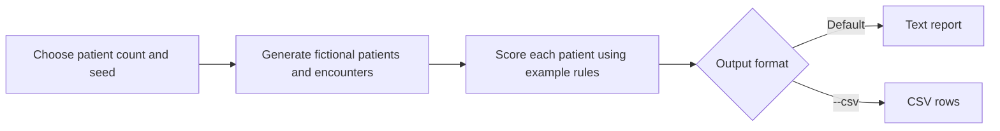

# Patient Analytics: Quick Guide

## What it does

`patient_analytics.py` creates a fictional patient cohort, gives each patient
an example risk score, and outputs a summary as text or CSV.

> **Training example only.** All data is fictional. The scores are not medical
> guidance. Never use this module with real patient data or for clinical
> decisions.

## How it works



The default rules add points for high blood pressure, glucose, or BMI, having
at least two conditions, and being age 65 or older. The total score maps to a
tier: **low** (0–1), **moderate** (2–4), **high** (5–7), or **critical** (8+).
These cutoffs are illustrative, not clinical thresholds.

## Main parts

- **`Patient` and `Vitals`** hold fictional patient details and dated
  measurements.
- **`generate_patients()`** creates patients and one to four encounters.
  The default seed (`1337`) makes generated data repeatable for the same
  inputs.
- **`assess_patient()`** applies the scoring rules and records reasons.
- **`render_report()`** summarizes measurements, tiers, conditions, and the
  five highest scores.
- **`write_csv()`** writes assessment rows to a text stream.
- An audit decorator and context manager record function calls and bracket a
  run in an in-memory log; this is only a training example, not a production
  audit control.

The report includes the current date and time, and patient ages use today's
date, so those values can change between runs even with the same random seed.

## Run it

From the repository root:

```shell
python Participants/Katie_Bond/patient_analytics.py
```

Useful options:

| Option | Default | Purpose |
|---|---:|---|
| `-n`, `--count` | `25` | Number of fictional patients |
| `-s`, `--seed` | `1337` | Seed for repeatable generated data |
| `--csv` | Off | Output CSV instead of the text report |

For example, `python Participants/Katie_Bond/patient_analytics.py -n 10 --seed 42 --csv`
outputs CSV for ten generated patients.
