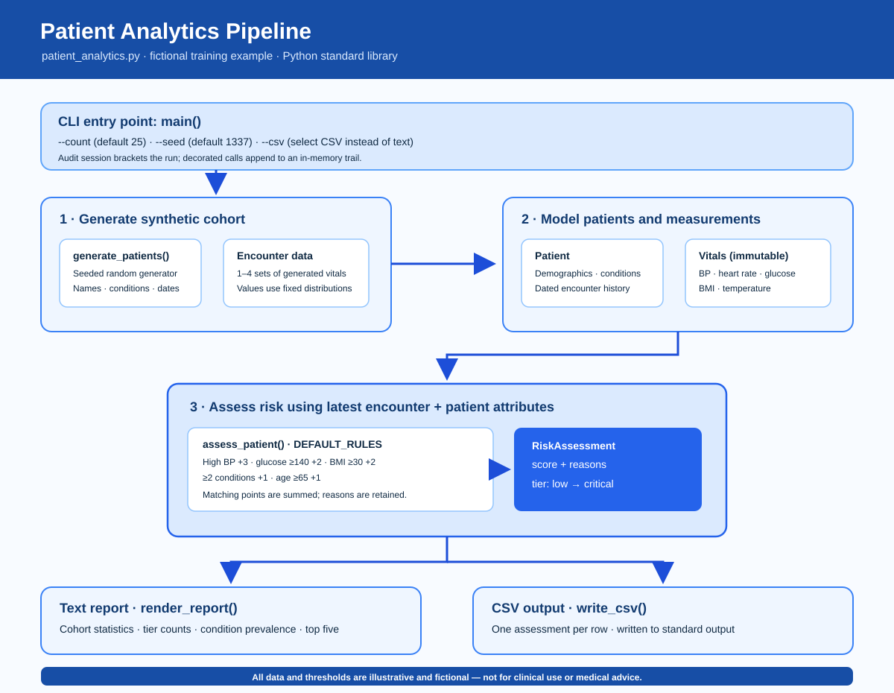

# Learning Outcomes

- **Name:** Owain Sweeting
- **Team:** Business & Transformation
- **Today I want to learn:** How to use GitHub and how to embed GitHub into our day to day work in PCCS

## What is in this folder

| File | Added in |
|------|----------|
| README.md | Session 2 |
| patient_analytics.py | Session 2 |
| patient_analytics_flow.svg | Session 2 |
| patient_analytics_technical_documentation.md | Session 2 |
| patient_report.sql | Session 2 |

