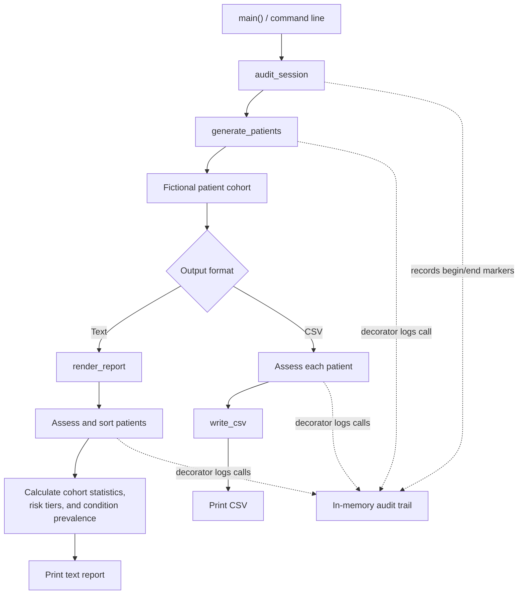

# Technical Guide: `patient_analytics.py`

## Purpose and scope

`patient_analytics.py` is a self-contained training example that generates a
fictional patient cohort, applies simple risk-scoring rules, and produces
summary reports. All names, medical record numbers, conditions, and
measurements are generated for demonstration purposes. The module is not a
clinical tool and its reference ranges and risk scores must not be used for
medical decisions.

## Processing flow

The command-line workflow is:

1. Generate a cohort with `generate_patients()`.
2. Assess each patient with `assess_patient()`.
3. Produce either the text report (`render_report()`) or CSV (`write_csv()`).
4. Record the run and decorated function calls in the in-memory audit trail.

The functions can also be imported and used independently.

## Data model

- **`Sex`** is an enum with `FEMALE`, `MALE`, and `OTHER` values.
- **`Vitals`** is a frozen dataclass for systolic and diastolic blood pressure,
  heart rate, glucose, BMI, and temperature. `as_dict()` exposes those values
  by metric name; `abnormal_flags()` compares each value with
  `REFERENCE_RANGES` and returns `"low"` or `"high"` flags.
- **`Patient`** stores a fictional MRN, name, birth date, sex, conditions, and
  dated vital-sign encounters. Its `full_name` and `age` properties derive
  display values; `latest_vitals()` returns the vitals from the latest dated
  encounter, or `None` when there are no encounters.
- **`RiskAssessment`** associates a patient with an integer score and a list
  of reasons. Its `tier` property maps the score to a `RiskTier`.

The patient and encounter collections are mutable. A `Vitals` object itself is
immutable after construction.

## Synthetic data generation

`generate_patients(count, seed=RANDOM_SEED)` creates patients using a local
`random.Random` instance. The default seed is `1337`; supplying the same count
and seed reproduces the generated data. Each patient receives zero to three
conditions from `CONDITION_POOL` and one to four dated encounters. Encounter
vitals are sampled from normal distributions in `_random_vitals()`.

The data is fabricated; generated values are not validated against real
clinical standards. Patient age is calculated against the current system date,
so age-related assessment results can change over time even when the generated
cohort is unchanged.

## Risk assessment

`DEFAULT_RULES` contains five rules. Each returns a point value and a
human-readable reason when it matches, or `None` otherwise:

| Rule | Condition | Points |
|------|-----------|--------|
| High blood pressure | Latest systolic BP ≥ 140 or diastolic BP ≥ 90 | 3 |
| Hyperglycemia | Latest glucose ≥ 140 | 2 |
| Elevated BMI | Latest BMI ≥ 30 | 2 |
| Multiple conditions | At least two listed conditions | 1 |
| Advanced age | Age ≥ 65 | 1 |

`assess_patient(patient, rules=DEFAULT_RULES)` runs the supplied rules, adds
their points, and collects their reasons. Rules are replaceable or extensible
through the `rules` sequence parameter. A patient without encounters can still
match the conditions-count or age rules.

`RiskTier.from_score()` classifies scores as **low** (below 2), **moderate**
(2–4), **high** (5–7), or **critical** (8 or above). These thresholds are
illustrative only.

## Reporting functions

- `cohort_statistics(patients)` calculates mean and median latest glucose,
  population standard deviation of latest BMI, and maximum latest glucose.
  Patients without encounters are excluded. It returns an empty dictionary
  when no patient has latest vitals.
- `tier_breakdown(assessments)` counts assessments by tier.
- `condition_prevalence(patients)` counts each condition and sorts the results
  by descending count.
- `write_csv(assessments, stream)` writes a header and one row per assessment
  to a text stream accepted by the `SupportsWrite` protocol.
- `render_report(patients)` assesses and sorts patients by descending score,
  then returns a text report with cohort statistics, tier counts, condition
  prevalence, and up to five highest-scoring patients.

## Audit mechanism

The `@audited(action)` decorator factory wraps selected functions and appends a
timestamp, action label, and function name to the module-level `_AUDIT_TRAIL`
before calling the original function. `audit_session(label)` is a context
manager that adds begin and end markers; its `finally` block ensures the end
marker is recorded if the enclosed work raises an exception. The trail is held
in memory and is not persisted to a file or external service.

## Command-line interface

Run the module with Python to use `main()`:

| Option | Default | Description |
|--------|---------|-------------|
| `-n`, `--count` | `25` | Number of fictional patients to generate |
| `-s`, `--seed` | `1337` | Random seed for reproducible generation |
| `--csv` | Off | Emit assessment rows as CSV instead of the text report |

For example, `python patient_analytics.py --count 10 --seed 42` prints the
text report, while adding `--csv` prints CSV to standard output. The CLI
returns exit status `0` on normal completion.

## Implementation notes

The module uses Python standard-library features including dataclasses, enums,
type hints, `Protocol`, generators, comprehensions, `functools.reduce`,
`Counter`, `defaultdict`, and a context manager. No external package is needed
to run it. `RANDOM_SEED` makes the random sequence reproducible, but report
timestamps and age calculations depend on the current system date and time.
