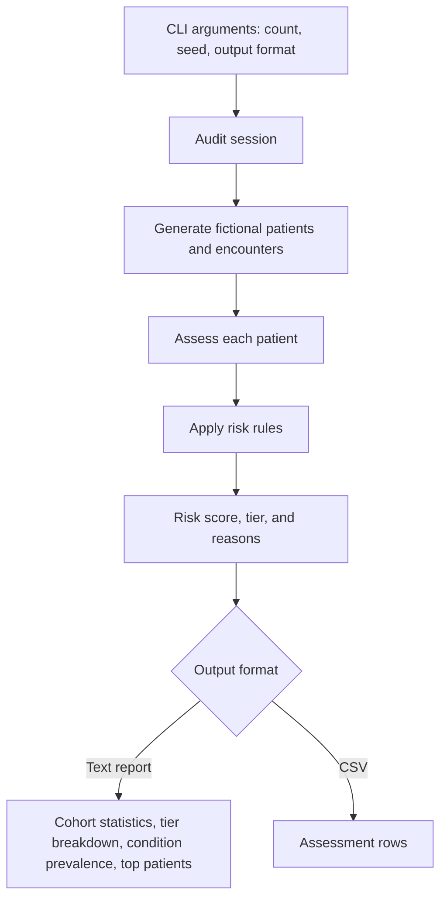

# Participant Details

- **Name:** Susmi Mariam Varughese
- **Team:** BI & Value - Finance
- **Today I want to learn:** GitHub

## What is in this folder

| File | Added in |
|------|----------|
| README.md | Session 2 |

## Patient analytics pipeline

The module uses fabricated data for training only; it is not for clinical use.

