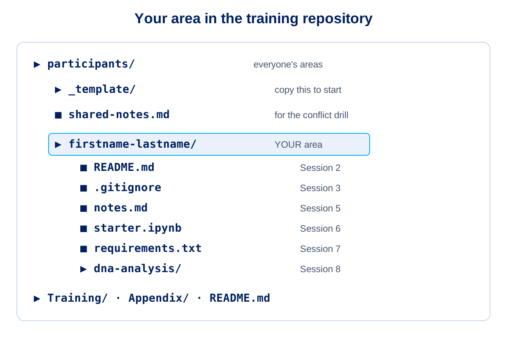

 

---

# Session 1: Introduction to GitHub and Why GitHub for Analytics and Data Teams?

**Duration**: 30 minutes  
**Time**: 09:00 - 09:30

## 🎯 Learning Objectives
By the end of this session, you will understand:
- What GitHub is and its fundamental purpose
- Why GitHub is essential for healthcare analytics teams
- Core Git concepts and terminology
- How version control improves collaboration and auditability
- The specific benefits for SQL, Python, and notebook workflows

---

## ✅ Before You Start: Setup and Access

Everyone needs to be signed in to GitHub and able to open a Codespace **before** the day. Follow [Setup and Access](00_Setup_and_Access.md), which has step-by-step instructions for:

- Joining the ABUHB organisation (Azure AD group `ABB_BIU_GitHub_Users`) and completing single sign-on
- Opening a Codespace, which is the workspace for the whole day (nothing to install; Git, GitHub Desktop and VS Code are optional)
- Optional: access to the ndr-hb-abuhb-academy Google Cloud project through the training Google group, for the SQL extension at the end of the day
- Creating, storing, testing and revoking a **fine-grained personal access token**, if your trainer asks for one

If you are not set up, use the first minutes of this session to fix it with the trainer. Contact the GitHub admin team at `ABB.BIU.GitHub.Admin@nhswales365.onmicrosoft.com`.

---

## 🏢 GitHub Enterprise Cloud: What We Use (Not GitHub Free)

ABUHB uses **GitHub Enterprise Cloud**. Your work lives in the ABUHB organisation, not in a personal GitHub Free account. This matters because several things in this training only exist on the paid plan.

| Capability | GitHub Free (personal) | ABUHB (Enterprise Cloud) |
|-----------|------------------------|--------------------------|
| Who controls access | You alone | The organisation, through single sign-on and groups |
| Private repositories | Yes, but few team controls | Yes, with organisation-wide policy |
| Protected branches and required reviews on private repositories | No | Yes |
| Audit log of who did what | No | Yes |
| Copilot | Individual plan, separate billing | Copilot Business, licensed by the organisation |
| Codespaces | Small free allowance, personal | Organisation policies and controls |
| Advanced Security (secret scanning, code scanning) on private repositories | No | Available as organisation-enabled products (Session 7) |
| Support | Community | Enterprise support |

> The exact features switched on for each repository are decided by the GitHub admin team. Plans and features change, so treat this table as a guide and check with the admin team.

**Rule:** do all NHS work only in the ABUHB organisation. Never use a personal Free account for it, and never move work between the two.

---

## 🧩 Your Area: Build as We Go

Throughout the day you build **your own area** in the training repository: `participants/<your-folder>/` on your own branch `training/<your-folder>`. At the end of each session there is a short **Your Area** checkpoint that adds one thing: a README, your own `.gitignore`, notes, a notebook, an issue, and finally your Copilot exercise. See [`participants/README.md`](../participants/README.md) for the full progression.

---

## 📚 What is GitHub?

**GitHub** is a cloud-based platform for version control and collaboration that allows multiple people to work on projects from anywhere (Location and IDE [IDE = Integrated Development Environment]).

### Core Components

#### Git (The Engine/Language)
- **Version Control System**: Tracks changes to files over time
- **Distributed**: Every user has a complete copy of the project history
- **Branching**: Create separate lines of development for different features and developments

#### GitHub (The Platform)
- **Web Interface**: Visual way to interact with Git repositories
- **Collaboration Tools**: Issues, pull requests, project boards
- **Cloud Storage**: Secure, reliable hosting for your code and data
- **Permissions & Access Control**: Manage who can view and edit your code

### How It Works
```
Local Computer          GitHub Cloud
     ↓                       ↓
[Your Code] ----Push---→ [Repository]
     ↑                       ↓
[Updated Code] ←--Pull--- [Shared Changes]
```

### Key Benefits for Any Organization
- **Backup**: Never lose work - everything is saved and tracked
- **History**: See exactly what changed, when, and who changed it
- **Collaboration**: Multiple people can work on the same project safely
- **Transparency**: All changes are visible and documented
- **Modularity**: Break down projects into smaller, manageable components

---

## 🏥 GitHub for Healthcare Analytics and Data Teams

GitHub is a collaborative platform enabling secure and efficient development and sharing of analytics tools and code across healthcare organisations.

### Purpose
Facilitate advanced analytics, data engineering, data science, and innovation in healthcare by breaking down silos and fostering collaboration.

### Key Benefits

#### Faster Development
- Remove technical barriers for collaborative work
- Reduce development timeframes through shared resources
- Enable rapid iteration and testing of analytics solutions

#### Enhanced Security
- Ensure secure code sharing within approved protocols
- Improve data protection through controlled access
- Maintain audit trails for compliance requirements

#### Improved Insights
- Enable efficient communication and partnership
- Facilitate code reuse for impactful healthcare insights
- Leverage collective intelligence across NHS Wales
- Acts as a change log for all modifications (this can be surfaced in pull requests and via GitHub API)


### Key Features

#### Secure Code Repository
- Central hub for storing, sharing, and collaborating on code
- Version control for all changes and iterations
- Backup and recovery capabilities

#### Collaboration Tools
- Enables teamwork across different healthcare organisations and departments
- Version control prevents conflicts and data loss
- Efficient project management and task tracking
- Enables collaboration with partners and stakeholders 

#### Governance Framework
- Adheres to information governance requirements
- Complies with data handling regulations
- Maintains security standards for data

---

## Why GitHub for Analytics and Data Teams?

### 1. Collaboration and Auditability

#### For SQL Development
```sql
-- Before: SQL files shared via email or network drives
-- Issues: Version conflicts, no change tracking, no review process

-- After: SQL in GitHub repositories
-- Benefits: Every change tracked, reviewed, and documented
```


#### For Python Analytics
```python
# Before: Python scripts in personal folders
# Issues: Code duplication, no standardization, limited sharing

# After: Centralized Python repositories
# Benefits: Shared libraries, consistent coding standards, collaborative development
```


#### For Jupyter Notebooks
- **Version Control**: Track changes to analysis workflows
- **Collaboration**: Multiple data scientists working on the same research
- **Reproducibility**: Ensure analyses can be repeated and verified
- **Documentation**: Combine code, results, and explanations

### 2. Single Source of Truth

#### Traditional Problems
- Multiple versions of the same data products scattered across systems 
- Uncertainty about which version is "current" or "approved" (v2, v2 Final, V2 Final Dan, V2 Final Prod)
- Difficulty tracking who made what changes when

#### GitHub Solution
- **One canonical repository** for each project, product, deployment or analysis
- **Clear branching strategy** for development vs. production
- **Tagged releases** for specific versions (e.g., "Q1-2024-Report")
- **Protected main branch** ensures only reviewed code reaches production

### 3. Rollback Capability

#### Scenario: Production Issue
```bash
# Problem: New SQL query causing performance issues
# Traditional approach: Manual restoration from backups

# GitHub approach: Simple rollback to previous working version
git revert <commit-hash>
# or
git reset --hard <previous-commit> # This statement using --hard means discarding all changes after the specified commit
```


### 4. Traceability Between Code, Tests, and Deployments

#### Complete Development Lifecycle
```
Issue Created → Branch Created → Code Developed → Tests Added → 
PR Opened → Code Reviewed → Merged → Deployed → Issue Closed
```

#### Compliance Benefits
- **Regulatory Audits**: Complete history of all changes
- **Quality Assurance**: Link between requirements and implementation
- **Risk Management**: Impact analysis for all modifications
- **Knowledge Transfer**: Documentation of decisions and rationale

---

## 🎓 Key Concepts Recap

### Core Git/GitHub Concepts

| Concept | Healthcare Analytics Context | Example |
|---------|----------------------------|---------|
| **Repository** | Project folder for analytics work | `patient-pathway-analysis` |
| **Commit** | Snapshot of your analysis at a point in time | "Add diabetes risk calculation" |
| **Branch** | Independent development line | `feature/RTT_Pop_up` |
| **Pull Request** | Request to review and merge changes | Code review for new DAG implementation |
| **Remote** | Shared repository on GitHub | Central repo for AB Tools |

> **Note**: These concepts will be explored in depth in Session 2 (Introduction to GIT), where you'll learn how GIT's architecture makes these features possible.

---

## 🏗️ Setting Up for Success

### Repository Structure for Healthcare Analytics

```
analytics-project/
├── README.md                 # Project overview and setup
├── sql/
│   ├── extracts/           # Data extraction queries
│   ├── transforms/         # Data transformation logic
│   └── reports/            # Reporting queries
├── python/
│   ├── src/                # Source code modules
│   ├── notebooks/          # Jupyter notebooks for analysis
│   └── tests/              # Unit tests for validation
├── docs/
│   ├── methodology/        # Analysis methodology documentation
│   ├── results/            # Analysis results and insights
│   └── compliance/         # Regulatory and governance docs
└── deployment/
    ├── configs/            # Configuration files
    └── scripts/            # Deployment automation
```

### 📦 Repository Provisioning and Governance

Organisations should establish a governance process for creating new repositories. This ensures consistency, security, and auditability.

#### Why Repository Governance?

- Enforces naming conventions and visibility defaults (private unless justified)
- Confirms data classification and security requirements
- Captures initial access permissions following least-privilege principles
- Links purpose → approval → configuration for audit trails
- Provides change traceability for repository configuration changes

#### Recommended Repository Request Information

| Field | Description |
|-------|-------------|
| Proposed Name | Clear, descriptive name using consistent conventions (e.g. `data-pipeline-analytics`) |
| Purpose / Scope | Concise description of the repository's intent |
| Data Classification | None / Aggregated / Synthetic / Sensitive (with appropriate controls) |
| Maintainers | Initial responsible users/teams |
| Team Access Matrix | Teams + permission levels (admin / maintain / write / triage / read) |
| Visibility | Usually `private` (public requires explicit approval and review) |
| Compliance Notes | Security, compliance, and validation requirements |
| Dependencies | Upstream data sources or systems |

#### Approval & Deployment Best Practices

1. Submit repository request through your organisation's governance process
2. Governance review: naming, classification, and access validation
3. Approved request recorded (for example a service ticket) with the agreed name, visibility and access
4. Repository created by an authorised administrator with the approved settings (branch protection, team access)
5. Maintainers confirm access works as agreed
6. Documentation of repository details and access

> Keep repository requests, approvals and settings documented and reviewable, so every repository is created and configured consistently. This reduces configuration drift and improves security.


### Naming Conventions

#### Branch Names

- `feature/new_api_onboarding`
- `bugfix/measure_Count`
- `data/new-patient-pathway-source`
- `hotfix/urgent_data_sync`

#### Commit Messages

```text
Add patient risk stratification model

- Implement logistic regression for admission risk
- Include age, comorbidities, and prior admissions
- Add validation against historical data
- Update documentation with model methodology

Closes #123
```

#### File Organization

- `extract_patient_data.sql` (descriptive, action-based)
- `transform_demographics.py` (clear purpose)
- `analyze_emergency_admissions.ipynb` (specific analysis)

---


**Discussion Points**

1. How does this workflow improve on email-based collaboration?
2. What compliance benefits does this provide for NHS Wales?
3. How would you handle an urgent bug fix in this system?
4. What happens if two analysts modify the same SQL file?

---

## Key Takeaways

### For Data Teams:

1. **Version Control is Essential**
   - NHS/Public Sector data must be accurate and auditable
   - Git provides the foundation for both requirements

2. **Collaboration Improves Quality**
   - Code review catches errors before they impact patient care
   - Shared knowledge leads to better analytical approaches

3. **Standardization Enables Scale**
   - Consistent processes across NHS Wales
   - Reusable components and methodologies

4. **Compliance is Built-In**
   - Audit trails and approval processes
   - Documentation and traceability requirements

### Success Metrics:
- Reduced time from analysis idea to implementation
- Improved accuracy through code review
- Increased collaboration across NHS Wales sites
- Enhanced compliance and audit readiness

---

## 🎯 Next Session Preview

**Session 2: Introduction to GIT**
- Understanding GIT as a version control system
- GIT's core architecture and object model
- The three-tree architecture: working directory, staging area, and repository
- How GIT tracks changes and ensures data integrity
- The distributed model and its benefits for NHS Wales teams

---

## 📖 Additional Resources

- [Official GitHub Documentation](https://docs.github.com/)
- [Git Documentation](https://git-scm.com/doc)
- [GitHub Skills - Interactive Learning](https://skills.github.com/)

---

<!-- SLIDES:BEGIN - generated by Training/slides/build_deck.py from slides/deck_content.yaml. Do not edit by hand. -->
## 🖥️ Slide Deck Content

These are the slides for this session: **slides 3–14** of [`GitHub_Training_Day.pptx`](GitHub_Training_Day.pptx). They are generated from [`slides/deck_content.yaml`](slides/deck_content.yaml), so the deck and this page always match. The sections above give the full detail behind each slide.

### Slide 3: Section divider

**Why GitHub for Data Teams** — Session 1 | 30 minutes

### Slide 4: What is GitHub?

**Git — the engine**

- Version control system that tracks changes to files over time
- Distributed — every user has a complete copy of the project history
- Branching — separate lines of development for different pieces of work

**GitHub — the platform**

- Web interface for working with Git repositories
- Collaboration tools — issues, pull requests and project boards
- Secure cloud hosting, with permissions and access control

> Git is the engine. GitHub is the platform built around it.

### Slide 5: GitHub Enterprise Cloud: What We Use (Not GitHub Free)

**ABUHB uses GitHub Enterprise Cloud**

- Our organisation is a paid Enterprise Cloud account, not a personal GitHub Free account
- You sign in with your ABUHB identity and access is controlled through the organisation
- Admins set the policies for repositories, Codespaces, Copilot and security

**What the paid plan gives us that Free does not**

- Enforced branch protection and required reviews on private repositories
- Organisation-wide access control, single sign-on and an audit log
- Copilot Business licences and organisation controls for Codespaces
- Advanced Security products for private repositories (covered in Session 7)

**Do your NHS work only in the ABUHB organisation. Never use a personal Free account for it.**

### Slide 6: Before You Start: Your Setup Checklist

**You should already have**

- A GitHub account that is a member of the ABUHB organisation (Azure AD group ABB_BIU_GitHub_Users)
- A browser that can open Codespaces (nothing else to install). GitHub Desktop and VS Code are optional
- Signed in to GitHub, with single sign-on authorised for the organisation
- Optional: access to the ndr-hb-abuhb-academy Google Cloud project, for the SQL extension at the end of the day
- A GitHub personal access token, stored safely, if your trainer asks for one

**If something is missing**

- Ask the GitHub admin team: ABB.BIU.GitHub.Admin@nhswales365.onmicrosoft.com
- Every new repository needs an approved HALO ticket

> Full step-by-step instructions are in Training/00_Setup_and_Access.md.

### Slide 7: Creating a Personal Access Token (PAT)

**A token is a password for one job**

- Open GitHub, then Settings, Developer settings, Personal access tokens, Fine-grained tokens
- Choose Generate new token, name it, and pick the ABUHB organisation as resource owner
- Set a short expiry and select only the repositories you need
- Give the least access: Contents and Pull requests read and write, Metadata read
- Copy the token once and save it in your credential manager or password manager

**Never put a token in code, a notebook, an issue or a Copilot prompt. If one leaks, revoke it at once.**

### Slide 8: GitHub for Healthcare Analytics

**Faster development**

- Remove technical barriers to collaborative work
- Reuse shared code and resources instead of starting again

**Enhanced security**

- Share code securely, within approved protocols
- Controlled access and an audit trail for compliance

**Improved insights**

- Efficient collaboration across teams and organisations
- A change log for every modification, surfaced in pull requests

### Slide 9: Why GitHub for Data Teams?

**Collaboration and auditability**

- SQL, Python and notebooks live in repositories — not email or personal folders
- Every change is tracked, reviewed and documented
- Notebooks gain version history and reproducibility

**Single source of truth**

- One canonical repository per project or product
- Protected main branch — only reviewed code reaches production
- Tagged releases for specific versions (for example "Q1-2024-Report")

### Slide 10: Rollback and Traceability

**Rollback**

- A production problem? Revert to the last working version
- No manual restoring from backups

**Traceability**

- Issue → Branch → Code → Tests → Pull Request → Review → Merge → Deploy → Issue closed
- Supports regulatory audit, quality assurance and knowledge transfer

### Slide 11: Setting Up Repositories for Success

**Repository structure**

- README.md for project overview and setup
- sql/ for extracts, transforms and reports
- python/ for source code, notebooks and tests
- docs/ for methodology, results and compliance

**Naming conventions**

- Branches — feature/new_api_onboarding, bugfix/measure_count, hotfix/urgent_data_sync
- Commit messages — a clear summary line, then detail, then "Closes #123"

### Slide 12: Repository Governance

**Why govern new repositories?**

- Consistent naming, and private by default
- Confirms data classification and security requirements
- Least-privilege access from day one
- Links purpose → approval → configuration for audit

**A repository request covers**

- Name, purpose and maintainers
- Data classification and visibility
- Team access levels and compliance notes

**No patient data in GitHub — ever.**

### Slide 13: How Access and New Repositories Work at ABUHB

**Access**

- Access comes from the Azure AD group ABB_BIU_GitHub_Users
- Questions go to the GitHub admin team

**New repositories**

- Raise a HALO ticket with the name, purpose, data classification and access list
- The admin team creates the repository once the ticket is approved

### Slide 14: Your Area: Checkpoint 1

**Find your area and open your workspace (5 minutes)**

- Sign in to GitHub with your ABUHB account and open the training repository
- Open the participants folder and find your folder, named firstname-lastname
- On the repository page choose Code, Codespaces, Create codespace on main: this is your workspace for the whole day
- Check that the terminal and editor open

**Your folder now contains**

- A running Codespace, and you know where your folder is: participants/<your-folder>



<!-- SLIDES:END -->

---

*Session 1 of 9 | GitHub Training Series for Analytics and Data Teams*  
*Developed by ABUHB Business Intelligence Team*
