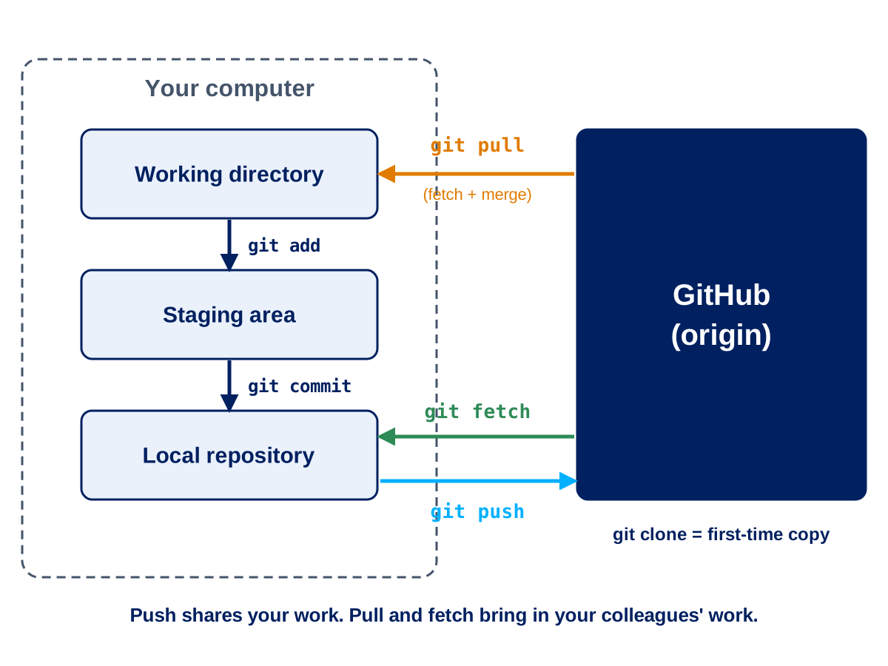
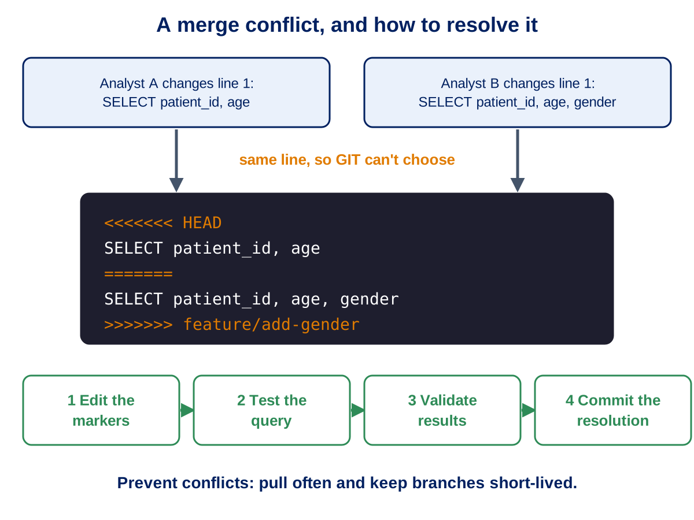

 

---

# Session 3: Branching and Sync Operations

**Duration**: 45 minutes  
**Time**: 10:15 - 11:00

## Learning Objectives

By the end of this session, you will understand:

- What branches are and why they're essential for data teams
- How to work with Working Directory, Staging Area, and Commits
- Remote operations: push, pull, fetch, and sync
- Clone vs Fork strategies for different collaboration scenarios
- Pull Request workflows for code review and quality assurance
- Conflict resolution strategies for SQL and notebook files

---

## What is a Branch?

### Definition

A **branch** is an independent line of development within a repository that allows experimentation without affecting main production code.

### Practical Context

Think of branches like different versions of your analysis:

- **main/master**: Production-ready reports and dashboards
- **feature/new-analysis**: New metrics development
- **bugfix/calculation-error**: Fix for incorrect calculations
- **data/new-source**: Integration of new data feed

### Key Benefits

#### 1. Safe Experimentation

```sql
-- On feature branch: experiment with new patient risk calculation
SELECT patient_id, 
       age, 
       comorbidity_score,
       -- New experimental risk factor
       (length_of_stay * readmission_history * 0.3) as risk_score
FROM patient_data;
```

#### 2. Parallel Development

- **Data Engineer A**: Working on quarterly reports (branch: `feature/q1-reports`)
- **Data Engineer B**: Developing new KPIs (branch: `feature/patient-safety-kpis`)
- **Data Engineer C**: Fixing data quality issues (branch: `bugfix/missing-demographics`)

#### 3. Code Review Process

All changes reviewed before affecting production analytics.

---

## Working Directory, Staging Area, Commit

### The Three-Stage Workflow

```
Working Directory  →  Staging Area  →  Repository History
     (edit)             (git add)        (git commit)
```

### Example: Updating Patient Metrics SQL

#### Working Directory

**What you see**: Files you're actively editing

```sql
-- patient_metrics.sql (modified in working directory)
SELECT 
    ward_id,
    COUNT(*) as patient_count,
    AVG(length_of_stay) as avg_los,
    -- Adding new metric for bed utilization
    (COUNT(*) / ward_capacity) * 100 as utilization_rate
FROM admissions a
JOIN wards w ON a.ward_id = w.ward_id
GROUP BY ward_id;
```

**Status**: File is modified but not yet staged for commit.

#### Staging Area

**What it does**: Prepares specific changes for commit

```bash
# Stage only the SQL file changes
git add patient_metrics.sql

# Or stage everything
git add .

# Or stage interactively (choose specific changes)
git add -p patient_metrics.sql
```

**Benefits for Data Teams**:

- Stage only tested changes
- Keep work-in-progress separate from ready changes
- Create focused, logical commits

#### Commit

**What it creates**: Permanent snapshot with metadata

```bash
git commit -m "Add bed utilization rate to patient metrics

- Calculate utilization as patient count / ward capacity
- Include ward capacity from wards table
- Add percentage formatting for dashboard display

Closes #156" <-- this is the 'Issue' ID.
```

**Commit contains**:

- Unique hash identifier
- Author and timestamp
- Descriptive message
- Complete snapshot of staged changes

---

## Remote (Origin) Explained

### What is a Remote?

A **remote** is a cloud-hosted copy of your repository (typically on GitHub) that enables team collaboration.

### Default Remote: "Origin"

```bash
# When you clone a repository
git clone https://github.com/nhs-wales/patient-analytics.git

# 'origin' automatically points to the GitHub repository
git remote -v
# origin  https://github.com/nhs-wales/patient-analytics.git (fetch)
# origin  https://github.com/nhs-wales/patient-analytics.git (push)

### In a Codespace the terminal and the Source Control view do these jobs for you
```

### Team Collaboration Flow

```
Local Repository ←→ Remote Repository (GitHub) ←→ Colleague's Local Repository
     (Your PC)         (Cloud/Shared)           (Colleague's PC)
```

---

## .gitignore - Excluding Files from Version Control

> **Your Area:** your own `.gitignore` lives in `participants/<your-folder>/`. Start from `participants/_template/.gitignore` and add a pattern of your own. See the checkpoint at the end of this session.


### What is .gitignore?

A `.gitignore` file tells Git which files and directories to never track or commit. This is crucial for data teams to prevent sensitive data, temporary files, and large datasets from being accidentally committed to repositories.

### Why .gitignore Matters for NHS Wales Analytics

#### 1. **Data Security & Compliance**
- Prevent accidental commit of patient data files
- Exclude connection strings and credentials
- Protect sensitive configuration files

#### 2. **Repository Cleanliness**
- Keep repos focused on code, not data or outputs
- Exclude temporary analysis files
- Prevent large files that slow down operations

#### 3. **Cross-Platform Compatibility**
- Handle OS-specific files (`.DS_Store`, `Thumbs.db`)
- Exclude IDE-specific configuration files

### Common .gitignore Patterns for Healthcare Analytics

#### Essential Data Protection
```gitignore
# Patient Data - NEVER commit actual patient data
*.csv
*.xlsx
*.xls
patient_data/
sensitive_data/
extracts/
raw_data/

# Database connection files
*.env
.env.local
connection_strings.txt
database_config.ini

# Backup files
*.bak
*.backup
*.sql.bak
```

#### Python Data Science Files
```gitignore
# Jupyter Notebook checkpoints
.ipynb_checkpoints/
*/.ipynb_checkpoints/*

# Python cache and compiled files
__pycache__/
*.py[cod]
*$py.class
*.so

# Virtual environments
venv/
env/
.venv/
analytics_env/

# Data science outputs
*.pkl
*.pickle
models/
outputs/
plots/
```


#### SQL and Database Files
```gitignore
# Local database files
*.db
*.sqlite
*.sqlite3
local_warehouse/

# SQL Server files
*.mdf
*.ldf

# Query result exports
query_results/
exports/
temp_tables/
```

#### System and IDE Files
```gitignore
# macOS
.DS_Store
.AppleDouble
.LSOverride

# Windows
Thumbs.db
ehthumbs.db
Desktop.ini

# VS Code
.vscode/settings.json
.vscode/launch.json

# JetBrains IDEs
.idea/
*.iml
```

### Example .gitignore for NHS Wales Analytics Project

```gitignore
# ===========================================
# NHS Wales Analytics Project .gitignore
# ===========================================

# CRITICAL: Patient and Sensitive Data
# Never commit actual patient data
patient_data/
sensitive_extracts/
*.csv
*.xlsx
*.xls
raw_data/
extracts/

# Database Connections & Credentials
.env
.env.*
database_config.ini
connection_strings.txt
secrets/
credentials/

# Analysis Outputs (Results should be in reports, not raw files)
outputs/
results/
exports/
temp_analysis/
*.pkl
*.pickle

# Jupyter Notebooks
.ipynb_checkpoints/
*/.ipynb_checkpoints/*

# Python
__pycache__/
*.py[cod]
*$py.class
venv/
env/
.venv/

# R Files
.Rhistory
.RData
.Rproj.user/

# SQL Temporary Files
temp_queries/
query_cache/
*.sql.bak

# System Files
.DS_Store
Thumbs.db
.vscode/settings.json

# Large Files and Backups
*.zip
*.tar.gz
*.7z
backup/
archive/

# Log Files
*.log
logs/
debug/
```

### How to Create and Use .gitignore

#### 1. Create the File
```bash
# Create .gitignore in your repository root
touch .gitignore

# Or use your text editor
code .gitignore
```

#### 2. Add Patterns
```bash
# Edit .gitignore file
echo "patient_data/" >> .gitignore
echo "*.csv" >> .gitignore
echo ".env" >> .gitignore
```

#### 3. Commit the .gitignore File
```bash
git add .gitignore
git commit -m "Add .gitignore for healthcare analytics project

- Exclude patient data files and sensitive information
- Ignore analysis outputs and temporary files  
- Prevent system files from being tracked"
```

#
```gitignore
# NHS Wales Analytics .gitignore Template
# Copy this to new projects and customize as needed

# ========================================
# SECURITY - NEVER COMMIT THESE
# ========================================
# Patient data
patient_data/
sensitive_data/
*.csv
*.xlsx
*.xls

# Credentials
.env*
secrets/
*.pem
*.key

# ========================================
# ANALYSIS OUTPUTS
# ========================================
outputs/
results/
exports/
models/
*.pkl

# ========================================
# DEVELOPMENT FILES  
# ========================================
# Python
__pycache__/
venv/
.ipynb_checkpoints/

# R
.Rhistory
.RData

# System
.DS_Store
Thumbs.db

# ========================================
# PROJECT SPECIFIC
# ========================================
# Add your project-specific exclusions here
```

### Integration with Data Governance

#### Compliance Benefits
- **Audit Trail**: .gitignore shows intentional data exclusion
- **Risk Mitigation**: Prevents accidental data exposure
- **Policy Enforcement**: Technical implementation of data handling rules

#### Documentation
```bash
# Document sensitive exclusions
git commit -m "Add .gitignore to prevent patient data commits

Security measures:
- All CSV/Excel files excluded by default
- Credentials and connection strings protected
- Analysis outputs separated from source code

Supports GDPR compliance and NHS data protection policies"
```

---

## Clone vs Fork

### Clone: For Team Members

**Use when**: You're a direct collaborator on the project

```bash
# Clone the main NHS Wales analytics repository
git clone https://github.com/nhs-wales/patient-analytics.git
```

**Permissions**: Direct access to push changes to shared branches

**Workflow**: Create feature branches, push directly, open pull requests

### Fork: For External Contributors

**Use when**: Contributing from outside the organization or for personal experimentation

```bash
# Fork creates your personal copy
# Original: https://github.com/nhs-wales/patient-analytics
# Your fork: https://github.com/your-username/patient-analytics

# Clone your fork
git clone https://github.com/your-username/patient-analytics.git

# Add original as upstream
git remote add upstream https://github.com/nhs-wales/patient-analytics.git
```

**Benefits**:

- Safe experimentation without affecting original
- Contribution workflow through pull requests
- Maintain connection to original project

---

## Push – Conceptual

### What Push Does

Push uploads your local commits to the remote branch (main or feature/dev), making your work visible to other collaborators.


### Basic Push Workflow

```bash
# After making commits locally
git push origin feature/patient-safety-metrics

# First time pushing new branch
git push -u origin feature/patient-safety-metrics
```

### Example

**Scenario**: You've developed new patient safety calculations

```sql
-- safety_metrics.sql
SELECT 
    ward_id,
    date_trunc('month', admission_date) as month,
    COUNT(CASE WHEN adverse_event = true THEN 1 END) as incidents,
    COUNT(*) as total_admissions,
    (COUNT(CASE WHEN adverse_event = true THEN 1 END) / COUNT(*)) * 100 as incident_rate
FROM patient_admissions
GROUP BY ward_id, date_trunc('month', admission_date);
```

**Push Process**:

1. Commit changes locally
2. Push to GitHub: `git push origin feature/patient-safety-metrics`
3. Colleagues can now see and review your work
4. Creates backup of your work in cloud
5. A PR can be made to pull this into production 'main''

--- 


In ABUHB, branch protection is applied to the `main` branch by default. This ensures that the `main` branch remains stable and production-ready at all times. The protection rules enforce specific policies to maintain code quality and prevent accidental changes.

#### Key Features of Branch Protection:

1. **Require Pull Request Reviews**:
    - All changes must go through a pull request and be reviewed by at least one team member before merging.

2. **Status Checks**:
    - Automated tests or checks (if configured) must pass before changes can be merged.

3. **Up-to-Date Branch Requirement**:
    - The branch being merged must be up-to-date with the `main` branch to avoid conflicts.

4. **Restricted Direct Pushes**:
    - Direct commits to the `main` branch are not allowed. All changes must go through the pull request workflow.

5. **Force Pushes Disabled**:
    - Force pushing to the `main` branch is prohibited to prevent overwriting history.

6. **Approval Policies**:
    - Specific reviewers or senior team members may be required to approve changes, especially for critical updates.

#### Benefits of Branch Protection:

- **Code Quality Assurance**: Ensures all changes are reviewed and tested before deployment.
- **Audit and Compliance**: Maintains a clear record of approvals and changes for regulatory purposes.
- **Risk Mitigation**: Prevents accidental or unauthorised changes to production code.
- **Team Collaboration**: Encourages a structured workflow with clear accountability.

By enforcing these rules, ABUHB ensures that the `main` branch remains a reliable source for production-ready code and analytics.


---

## Pull – Conceptual

### What Pull Does

Pull brings remote changes into your local branch and integrates them (fetch + merge in one action).

### Basic Pull Workflow

```bash
# Update your current branch with remote changes
git pull origin main

# More explicit version
git fetch origin  # Download changes
git merge origin/main  # Integrate changes
```

###  Example

**Scenario**: Colleague updated shared patient demographics functions

**Your situation**:

- You're working on admission analysis
- Colleague improved the age calculation function
- You need the latest version

```bash
# Pull latest changes
git pull origin main

# Now your local code includes colleague's improvements
```

**Result**: Your analysis now uses the improved demographic calculations.

---

## Fetch – Conceptual

### What Fetch Does

Fetch downloads remote changes but does **not** merge them automatically. Use fetch to inspect remote changes before integrating.

### When to Use Fetch

```bash
# Download remote changes without merging
git fetch origin

# See what changed
git log origin/main --oneline

# See differences
git diff main origin/main

# If you're happy with changes, then merge
git merge origin/main
```

### Example

**Scenario**: Production patient report queries were updated

**Safe approach**:

1. **Fetch first**: See what changed without affecting your work
2. **Review changes**: Ensure updates won't break your analysis
3. **Merge when ready**: Integrate after verification

```bash
git fetch origin
git log --oneline main..origin/main  # See new commits
git diff main origin/main            # See code changes
# If satisfied:
git merge origin/main
```

---

## Sync in GUI Tools

### What Sync Does

Sync in GitHub Desktop and VS Code typically performs pull then push to align local and remote repositories.

### Sync Workflow

```
Sync = Pull (get remote changes) + Push (send local changes)
```

### When Sync is Useful

- **Daily routine**: Start day by syncing with team changes
- **After commits**: Share your work and get updates
- **Before major work**: Ensure you have latest codebase

### GUI Tool Benefits

- **One-click operation**: Simplified workflow for non-technical users
- **Visual feedback**: See incoming and outgoing changes
- **Conflict detection**: GUI helps resolve merge conflicts

---

## Checkout – Switching Contexts

### What Checkout Does

Checkout switches your working directory to another branch or commit, changing which version of files you see.

### Branch Switching

```bash
# Switch to main branch
git checkout main

# Switch to feature branch
git checkout feature/emergency-analysis

# Create and switch to new branch
git checkout -b feature/covid-metrics
```

### Example

**Multi-analysis workflow**:

```bash
# Working on quarterly reports
git checkout feature/q1-reports
# Edit quarterly_summary.sql

# Urgent: need to fix production dashboard
git checkout main
git checkout -b hotfix/dashboard-error
# Fix critical_metrics.sql

# Back to quarterly work
git checkout feature/q1-reports
# Continue with quarterly analysis
```

**Benefits**:

- **Context switching**: Work on multiple analyses simultaneously
- **Isolation**: Changes in one branch don't affect others
- **Emergency fixes**: Quick response to production issues

---

## Creating Branches – Naming & Strategy

### Branch Naming Conventions

#### For ABUHB Data Teams

```bash
# Feature development
feature/patient-flow-analysis
feature/covid-dashboard-metrics
feature/bed-utilization-kpis

# Bug fixes
bugfix/admission-count-error
bugfix/demographics-missing-data
hotfix/critical-dashboard-fix

# Data integration
data/new-patient-source
data/theatre-system-integration
data/lab-results-feed

# Maintenance
chore/update-documentation
chore/cleanup-old-queries
chore/performance-optimization
```

### Strategic Approach

#### Short-lived Branches

**Recommended**: Keep branches focused and short-lived (days to weeks, not months)

**Benefits**:

- Easier integration
- Fewer conflicts
- Faster feedback
- Reduced risk

#### Example Timeline

```
Day 1: Create feature/patient-readmission-analysis
Day 2-3: Develop SQL queries and validation
Day 4: Open pull request for review
Day 5: Address review feedback
Day 6: Merge to main, delete feature branch
```

---

## Merge – Bringing Changes Together

### What Merge Does

Merge integrates commits from one branch into another, combining development work.

### Types of Merges

#### 1. Fast-Forward Merge

**When**: Target branch hasn't changed since feature branch was created

```
main:     A---B
              \
feature:       C---D

After merge:
main:     A---B---C---D
```

**Result**: Linear history, no merge commit created

#### 2. Three-Way Merge

**When**: Both branches have new commits

```
main:     A---B---E
              \
feature:       C---D

After merge:
main:     A---B---E---M
              \     /
feature:       C---D
```

**Result**: Merge commit (M) combines both histories

#### 3. Squash Merge

**When**: You want to combine all feature commits into one

```
feature:  A---B---C---D (multiple small commits)

After squash merge:
main:     A---B---S (S contains all changes from C and D)
```

**Benefits**: Clean main branch history

---

## Pull Requests – Purpose & Benefits

### What is a Pull Request?

A **Pull Request (PR)** is a formal mechanism to review and discuss changes before merging into the main codebase.

### Benefits

#### 1. Code Review for Data Quality

```sql
-- PR Review Checklist for SQL Changes:
-- ✅ Does the logic correctly calculate patient metrics?
-- ✅ Are there any data quality issues?
-- ✅ Will this change affect downstream reports?
-- ✅ Are the performance implications acceptable?
```

#### 2. Knowledge Sharing

- **Learning**: Junior analysts learn from senior review
- **Documentation**: Discussions explain business logic
- **Standardisation**: Consistent coding patterns across team

#### 3. Audit Trail

- **Compliance**: Complete record of who approved what changes
- **Traceability**: Link between business requirements and code
- **Risk management**: Evidence of proper review process

### PR Workflow for NHS Wales

```
1. Create feature branch
2. Develop analysis/code
3. Open Pull Request
4. Automated checks run (if configured)
5. Team members review
6. Address feedback
7. Approve and merge
8. Deploy to production
```

---

## ✅ Review Checklist for PRs 

### SQL Query Reviews

#### Data Accuracy Checks

```sql
-- Example: Review checklist for patient metrics query
-- ✅ Verify patient inclusion criteria
-- ✅ Check date range logic
-- ✅ Validate aggregation calculations
-- ✅ Confirm exclusion criteria (e.g., test patients)
```

#### Performance Considerations

- **Query efficiency**: Will this run within acceptable time limits?
- **Resource usage**: Impact on database performance during business hours?
- **Indexing**: Are appropriate indexes being used?

#### Downstream Impact Assessment

- **Dependencies**: What reports or dashboards use this data?
- **Schema changes**: Do field renames affect other systems?
- **Data format**: Are date formats and units consistent?

### Python/Notebook Reviews

#### Code Quality

```python
# Review checklist for data analysis code:
# ✅ Are functions properly documented?
# ✅ Is error handling appropriate for healthcare data?
# ✅ Are assumptions clearly stated?
# ✅ Is the analysis reproducible?
```

#### Data Science Best Practices

- **Validation**: Are results validated against known benchmarks?
- **Methodology**: Is the analytical approach sound?
- **Interpretability**: Can results be easily explained to clinicians?

---

## Why Conflicts Happen

### Common Conflict Scenarios

#### 1. Same File, Same Lines

```sql
-- Analyst A changes:
SELECT patient_id, age FROM demographics;

-- Analyst B changes (same line):
SELECT patient_id, age, gender FROM demographics;

-- Result: Git can't automatically decide which is correct
```

#### 2. Notebook Conflicts

Jupyter notebooks are particularly prone to conflicts because:

- JSON format is complex
- Cell metadata changes frequently
- Output data can cause conflicts
- Execution counts differ between runs

#### 3. Large SQL Files

```sql
-- conflict_example.sql
-- Long procedures or complex queries where multiple analysts
-- modify different sections that Git considers overlapping
```

### Prevention Strategies

#### 1. Frequent Syncing

```bash
# Pull latest changes regularly
git pull origin main
```

#### 2. Small, Focused Changes

- Keep commits small and focused
- Merge frequently to avoid divergence
- Coordinate with team on large changes

#### 3. File Organization

```
sql/
├── extracts/
│   ├── patient_data.sql      # One analyst
│   └── lab_results.sql       # Another analyst
├── transforms/
│   ├── demographics.sql      # Shared - coordinate changes
│   └── calculations.sql      # Shared - coordinate changes
```

---

## Resolving Conflicts – Conceptual Approach

### Step-by-Step Resolution

#### 1. Identify Conflicting Areas

Git marks conflicts with special markers:

```sql
<<<<<<< HEAD
-- Your changes
SELECT patient_id, age, gender FROM demographics;
=======
-- Colleague's changes  
SELECT patient_id, age, diagnosis FROM demographics;
>>>>>>> feature/add-diagnosis
```

#### 2. Decide Correct Logic

**Questions to ask**:

- Which change meets the business requirement?
- Can both changes be combined?
- Do we need to consult with clinical team?

#### 3. Manual Resolution

```sql
-- Resolution: Include both gender and diagnosis
SELECT patient_id, age, gender, diagnosis FROM demographics;
```

#### 4. Test and Validate

```bash
# After resolving conflicts:
# 1. Remove conflict markers
# 2. Test the query
# 3. Validate results
# 4. Commit the resolution

git add resolved_file.sql
git commit -m "Resolve merge conflict: include both gender and diagnosis fields"
```

### Validation

#### For SQL Conflicts

```sql
-- Always test resolved queries:
-- 1. Run sample query with small date range
-- 2. Verify row counts are reasonable
-- 3. Check for data type issues
-- 4. Validate against known benchmarks
```


---

## Rebasing – Conceptual Overview

### What is Rebasing?

Rebasing moves your branch to a new base commit, rewriting history to create a linear progression.

### Before Rebase

```
main:     A---B---C
              \
feature:       D---E
```

### After Rebase

```
main:     A---B---C
                  \
feature:           D'---E'
```

### Benefits for Data Teams

#### 1. Clean History

- Linear progression easy to follow
- Clear chronological order of changes
- Simplified debugging and rollback

#### 2. Updated Base

- Feature branch includes latest main branch changes
- Reduces merge conflicts later
- Ensures compatibility with latest code

### When to Use Rebase

```bash
# Update feature branch with latest main
git checkout feature/patient-metrics
git rebase main
```

**⚠️ Important**: Only rebase branches you haven't shared (pushed) yet, as it rewrites commit hashes.

---


## Protected Branches & Merge Policies

### What are Protected Branches?

Protected branches enforce rules to prevent accidental changes and ensure code quality.

### Protection Rules

#### Main/Master Branch Protection

```yaml
Protection Rules:
✅ Require pull request reviews before merging
✅ Dismiss stale reviews when new commits are pushed  
✅ Require status checks to pass before merging
✅ Require branches to be up to date before merging
✅ Restrict pushes that create public pull requests
✅ Restrict who can dismiss pull request reviews
```

#### Benefits for Data Teams

1. **Quality Assurance**: All production code reviewed
2. **Audit Trail**: Complete record of approvals
3. **Risk Reduction**: Prevents accidental production changes
4. **Compliance**: Supports regulatory requirements

### Example Policy for Patient Data Analysis

```
Main Branch Rules:
- Minimum 1 reviewer approvals required
- Senior analyst/engineer approval required for schema changes
- Automated tests must pass
- No direct pushes allowed
- Force pushes disabled
```

---

## Branching Strategies – Practical Advice

### Recommended Strategy: Simplified Git Flow

Perfect for NHS Wales analytics teams:

```
main (production-ready code)
├── feature/patient-flow-analysis
├── feature/covid-metrics  
├── hotfix/urgent-dashboard-fix
└── data/new-patient-source -- NO DATA STORED IN GITHUB
```

### Branch Lifecycle

#### 1. Feature Development

```bash
# Start new analysis
git checkout main
git pull origin main
git checkout -b feature/emergency-admission-analysis

# Develop and commit
# ... work on analysis ...
git commit -m "Add emergency admission risk factors"

# Open pull request when ready
```

#### 2. Review and Integration

```bash
# After PR approval
git checkout main
git pull origin main
git merge feature/emergency-admission-analysis
git branch -d feature/emergency-admission-analysis
```

#### 3. Hotfix Process

```bash
# Urgent production fix
git checkout main
git checkout -b hotfix/critical-metric-error
# Fix issue quickly
git commit -m "Fix critical patient count calculation"
# Immediate merge after minimal review
```

### Team Size Considerations

#### Small Teams (2-5 team members)

- Simple feature branches off main
- Direct merges after review
- Minimal branching overhead

#### Larger Teams (6+ team members)

- Feature branches with longer lifecycles
- Release branches for coordinated deployments
- More structured review process

---

## Commit Message Best Practices

### Format for Data Teams

```bash
git commit -m "Short description (50 chars or less)

Detailed explanation of the change:
- What was changed and why
- Impact on existing analyses
- Any breaking changes or dependencies

Closes #123
Refs #456"
```

### Examples

#### Good Commit Messages

```bash
# SQL update
git commit -m "Improve patient readmission calculation accuracy

- Fix date range logic for 30-day readmissions
- Exclude same-day transfers from count  
- Add validation against historical benchmarks
- Performance improvement: 2.3s to 0.8s query time

Closes #245"

# Python analysis  
git commit -m "Add COVID-19 vaccination impact analysis

- Implement patient cohort matching algorithm
- Calculate vaccination effectiveness metrics
- Add statistical significance testing
- Include confidence intervals in results

Refs #189"
```

#### Avoid These Patterns

```bash
# Too vague
git commit -m "fix stuff"
git commit -m "update query"

# No context
git commit -m "changed admissions.sql"

# Too long first line
git commit -m "Fix the patient admission calculation query that was returning incorrect counts for emergency department visits during weekend periods"
```

### Link to Issues

```bash
# Link commit to specific issues
Closes #123    # Automatically closes issue when merged
Fixes #456     # Same as closes
Refs #789      # References issue without closing
```

---

## Atomic Commits & Granularity

### What are Atomic Commits?

Each commit represents one logical change that could be safely reverted without affecting other functionality.

### Here are some examples

#### ✅ Good Atomic Commits

```bash
# Commit 1: Single logical change
git commit -m "Add patient age stratification to readmission analysis"

# Commit 2: Separate logical change  
git commit -m "Fix date handling for weekend admissions"

# Commit 3: Independent improvement
git commit -m "Add performance indexes for faster patient queries"
```

#### ❌ Avoid Mixed Changes

```bash
# Bad: Multiple unrelated changes
git commit -m "Fix readmission bug, add new metrics, update documentation, refactor code"
```

### Benefits for Data Teams

#### 1. Easier Debugging

```bash
# If patient metrics suddenly wrong, easy to identify cause:
git log --oneline
abc123 Add new comorbidity scoring
def456 Fix weekend admission logic  ← Likely culprit
ghi789 Update patient demographics query
```

#### 2. Selective Rollback

```bash
# Rollback just the problematic change
git revert def456
```

#### 3. Clear Audit Trail

Each commit addresses one specific analytical requirement or bug fix.

### Practical Guidelines

#### File Organization

```bash
# Good: Logical grouping
git add patient_metrics.sql
git commit -m "Update patient risk calculation methodology"

git add dashboard_queries.sql  
git commit -m "Add real-time bed occupancy metrics"

# Avoid: Mixing unrelated files
git add *
git commit -m "Various updates"
```

---

## Review Checks & CI for Data Teams (Conceptual)

### Automated Quality Checks

#### SQL Validation

```yaml
# GitHub Actions example for SQL checking
name: SQL Quality Check
on: [pull_request]
jobs:
  sql-lint:
    runs-on: ubuntu-latest
    steps:
      - uses: actions/checkout@v2
      - name: SQL Lint
        run: |
          # Check SQL syntax
          sqlfluff lint sql/
          # Validate against style guide
          sqlfluff fix --check sql/
```

---

## Permissions & Access Control

### Repository Roles for NHS Wales

#### Read Access

- **Who**: Stakeholders, managers, external auditors
- **Capabilities**: View code, download releases, read documentation
- **Use case**: Transparency and audit requirements

#### Triage Access

- **Who**: Senior analysts, team leads
- **Capabilities**: Manage issues and pull requests, apply labels
- **Use case**: Project management and workflow coordination

#### Write Access

- **Who**: Active development team members
- **Capabilities**: Push to non-protected branches, open pull requests
- **Use case**: Daily development work

#### Maintain Access

- **Who**: Technical leads, senior developers
- **Capabilities**: Manage settings, moderate discussions, block users
- **Use case**: Repository administration

#### Admin Access

- **Who**: Project owners, IT administrators
- **Capabilities**: Full control including security settings
- **Use case**: Strategic decisions and security management

### Team-Based Permissions

#### Example Structure

```
ABUHB Org
├── @nhs-wales/Analytics-engineers (Write access)
│   ├── Analytical engineers
├── @nhs-wales/Data-engineers (Maintain access)
│   ├── Data Engineers
└── @nhs-wales/admins (Admin access)
    ├── BIU Seniors
```

---

## Common Troubleshooting Scenarios (Conceptual)

### Scenario 1: Cannot Push - Remote has Newer Commits

#### Problem

```bash
git push origin feature/patient-analysis
# Error: Updates were rejected because the remote contains work that you do not have locally
```

#### Solution

```bash
# Pull remote changes first
git pull origin feature/patient-analysis
# Resolve any conflicts if they exist
# Then push your changes
git push origin feature/patient-analysis
```

#### Prevention

- Pull before starting work each day
- Communicate with team about shared branches
- Use short-lived feature branches

### Scenario 2: Merge Conflicts in Notebooks

#### Problem

Jupyter notebooks store metadata that often conflicts:

```json
{
 "execution_count": 15,  // Different on each machine
 "metadata": {
   "kernelspec": {
     "display_name": "Python 3 (ipykernel)"  // Environment differences
   }
 }
}
```

#### Solutions

```bash
# Option 1: Use notebook merge tools
pip install nbdime
git config merge.ours.driver true
echo "*.ipynb merge=ours" >> .gitattributes

# Option 2: Clear outputs before committing
jupyter nbconvert --clear-output --inplace analysis.ipynb
git add analysis.ipynb
git commit -m "Add patient outcome analysis notebook"
```

#### Best Practices

- Clear outputs before committing
- Use `.gitignore` for checkpoint files
- Consider using scripts for production analysis

### Scenario 3: Accidental Commits to Main Branch

#### Problem

```bash
# Oops! Committed directly to main instead of feature branch
git status
# On branch main
# nothing to commit, working tree clean
```

#### Solution

```bash
# Create feature branch from current position
git checkout -b feature/patient-metrics

# Reset main to previous state
git checkout main
git reset --hard HEAD~1  # Remove last commit from main

# Continue work on feature branch
git checkout feature/patient-metrics
```

#### Prevention

- Set up branch protection rules
- Use Git hooks to prevent direct commits to main
- Always create feature branches before starting work
---
### Benefits for NHS Wales

#### 1. Reproducible Infrastructure

- **Version controlled**: All infrastructure changes tracked
- **Environment parity**: Dev/staging/prod consistency  
- **Audit trail**: Complete deployment history

#### 2. Automated Quality Assurance

- **Testing**: Automated validation before production
- **Rollback**: Easy reversion if issues detected
- **Monitoring**: Integrated health checks and alerting

#### 3. Compliance and Security

- **Access control**: Managed through infrastructure code
- **Encryption**: Consistent security policies
- **Audit logs**: Complete activity tracking for compliance

---

##  Session 3 Recap

### Key Concepts Mastered

#### 1. Branching Strategy

- **Short-lived branches** for focused analytics work
- **Clear naming conventions** for healthcare projects
- **Protection rules** for production code quality

#### 2. Collaboration Workflow

- **Pull Requests** as quality gates for data teams
- **Code review** focused on data accuracy and methodology
- **Merge strategies** appropriate for team size and project needs

#### 3. Conflict Resolution

- **Prevention** through frequent syncing and communication
- **Resolution** with focus on data integrity and business logic
- **Validation** to ensure analytical correctness

#### 4. Production Readiness

- **Protected main branch** ensures production stability
- **Automated testing** for data quality and performance


## 🎯 Next Session Preview

**Session 4: GitHub Cloud Interface and Navigation**

- Understanding the GitHub web interface for analytics teams
- Navigating code, commits, and file history
- Using diff views for SQL and notebook changes  
- Insights and analytics for team productivity
- Project management features for analytics workflows


---

<!-- SLIDES:BEGIN - generated by Training/slides/build_deck.py from slides/deck_content.yaml. Do not edit by hand. -->
## 🖥️ Slide Deck Content

These are the slides for this session: **slides 22–29** of [`GitHub_Training_Day.pptx`](GitHub_Training_Day.pptx). They are generated from [`slides/deck_content.yaml`](slides/deck_content.yaml), so the deck and this page always match. The sections above give the full detail behind each slide.

### Slide 22: Section divider

**Branching and Sync Operations** — Session 3 | 45 minutes

### Slide 23: Branches and the Three-Stage Workflow

**Branches**

- A branch is a safe draft — changes don't affect anyone until merged
- Short-lived branches for focused pieces of analytics work

**Working directory → staging area → commit**

- Stage only the files that belong together
- Commit small, logical changes (atomic commits)
- Write messages that say what changed and why, linked to an issue

### Slide 24: Remotes — Clone, Fork, Push, Pull and Fetch

**Getting the code**

- Origin — the default name for the shared repository on GitHub
- Clone — for team members
- Fork — for external contributors

**Keeping in sync**

- Push — send your commits to GitHub
- Pull — bring in colleagues' changes
- Fetch — download changes without merging, so you can look first

> Your Codespace signs you in to GitHub, so syncing is just pull and push. More on the daily workflow in Session 5.



### Slide 25: .gitignore — Keeping Data Out

**Always exclude**

- Patient and sensitive data files
- Credentials and connection files
- Query result exports and local databases
- Notebook checkpoints, Python caches and virtual environments

**Make it a habit**

- Create .gitignore at the repository root on day one
- Start from the team template and add project-specific exclusions

**Never commit patient data.**

### Slide 26: Pull Requests and Review

**The pull request workflow**

- Create branch → develop → open PR → automated checks → review → address feedback → approve and merge

**What reviewers check**

- SQL — inclusion and exclusion criteria, date logic, aggregations, performance
- Python — documented functions, error handling, stated assumptions, reproducible
- Downstream impact on reports and dashboards

### Slide 27: Conflicts and Rebasing

**Why conflicts happen**

- Two people change the same lines of the same file
- Notebooks conflict easily — JSON, metadata and outputs

**Resolving safely**

- Pull often to prevent them
- Edit the conflict markers, test the query, validate the results, then commit
- Rebase to update your branch with the latest main



### Slide 28: Protected Branches and Branching Strategy

**Protect main**

- Pull request and review required before merging
- Status checks must pass
- No direct pushes and no force pushes

**Keep it simple**

- Simplified Git flow — main plus short-lived feature, bugfix and hotfix branches
- Smaller pull requests get faster, better reviews

**No data is stored in GitHub — code only.**

### Slide 29: Your Area: Checkpoint 3

**Add your .gitignore and share it (5 minutes)**

- Copy participants/_template/.gitignore into your folder and add one pattern of your own, for example *.log
- Create notes.csv and check that git status does not list it
- Commit, then push your branch (Codespaces signs you in for you)
- Open a draft pull request into main (do not merge yet)

**Your folder now contains**

- README.md and .gitignore on your pushed branch, with an open draft pull request

<!-- SLIDES:END -->

---

*Session 3 of 9 | GitHub Training Series for Analytics and Data Teams*  
*Developed by ABUHB Business Intelligence Team*
