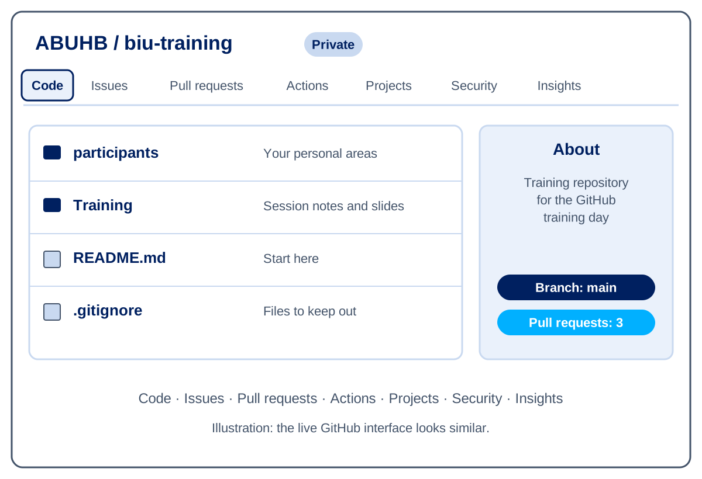

 

---

# Session 4: GitHub Cloud Interface and Navigation

**Duration**: 30 minutes  
**Time**: 11:00 - 11:30

## Learning Objectives

By the end of this session, you will be able to:

- Navigate the GitHub web interface efficiently for analytics projects
- Use key views: Code, Commits, Branches, Pull Requests, Actions, and Insights
- Understand file history and diff views for SQL and notebook changes
- Find and track data assets across repositories
- Use GitHub's search and navigation features for large analytics projects

---

## GitHub Cloud Interface Overview

### Main Navigation Areas

When you visit a GitHub repository, you'll see several key navigation tabs:

#### Code Tab
- **Purpose**: Browse repository files and folders
- **Analytics Use**: View SQL scripts, Python notebooks, documentation
- **Key Features**: File preview, download, edit online

#### Issues Tab  
- **Purpose**: Track bugs, feature requests, and tasks
- **Analytics Use**: Data requests, methodology discussions, bug reports
- **Key Features**: Labels, assignments, linking to code changes

#### Pull Requests Tab
- **Purpose**: Review and discuss code changes before merging
- **Analytics Use**: Code review for SQL queries, model validation
- **Key Features**: Diff view, discussions, approval workflow

#### Actions Tab
- **Purpose**: View automated workflows and CI/CD pipelines
- **Analytics Use**: Data validation, report generation, model deployment
- **Key Features**: Workflow runs, logs, artifact downloads

#### Projects Tab
- **Purpose**: Kanban-style project management
- **Analytics Use**: Track analysis backlog, sprint planning
- **Key Features**: Custom fields, automation, progress tracking

#### Insights Tab
- **Purpose**: Repository analytics and contributor statistics
- **Analytics Use**: Team productivity, code activity patterns
- **Key Features**: Commit history, contributor activity, code frequency

---

## Code View: Navigating Data Assets

### Repository File Structure for Analytics

#### Typical Repository Layout

```text
nhs-wales-patient-analytics/
├── 📁 sql/
│   ├── 📁 extracts/        # Data extraction queries
│   ├── 📁 transforms/      # Data transformation scripts
│   ├── 📁 reports/         # Reporting and dashboard queries
│   └── 📁 procedures/      # Stored procedures
├── 📁 python/
│   ├── 📁 notebooks/       # Jupyter analysis notebooks
│   ├── 📁 src/            # Python modules and packages
│   ├── 📁 tests/          # Unit tests and validation
│   └── 📁 models/         # Machine learning models
├── 📁 docs/
│   ├── 📁 methodology/     # Analysis documentation
│   ├── 📁 reports/        # Generated reports and findings
│   └── 📁 compliance/     # Regulatory documentation
└── 📁 config/
    ├── 📁 environments/    # Environment-specific settings
    └── 📁 deployment/     # Deployment configurations
```

### File Preview Features

#### SQL File Preview

When you click on a SQL file, GitHub provides:

```sql
-- Example: patient_admissions_monthly.sql
-- GitHub shows syntax highlighting and line numbers

SELECT 
    hospital_site,
    DATE_TRUNC('month', admission_date) as report_month,
    COUNT(*) as total_admissions,
    COUNT(CASE WHEN emergency = true THEN 1 END) as emergency_admissions,
    AVG(length_of_stay) as avg_length_of_stay
FROM patient_admissions 
WHERE admission_date >= '2024-01-01'
GROUP BY hospital_site, DATE_TRUNC('month', admission_date)
ORDER BY hospital_site, report_month;
```

**GitHub Features**:
- ✅ Syntax highlighting for SQL
- ✅ Line numbers for easy reference
- ✅ Copy button for quick sharing
- ✅ Raw view for downloading
- ✅ Edit button (if you have permissions)

#### Jupyter Notebook Preview

GitHub renders Jupyter notebooks with:

- **Code cells**: Syntax-highlighted Python/R/SQL
- **Markdown cells**: Formatted documentation and explanations
- **Output cells**: Results, charts, and visualisations (static)
- **Metadata**: Kernel information and execution details
- NB YOU MUST CLEAR ALL OURPUTS BEFORE COMMIT!

### File Navigation Tips

#### Using the File Finder

- **Keyboard shortcut**: Press `t` to open file finder
- **Search**: Type filename or path to quickly locate files
- **Filters**: Use `/` to navigate to specific folders

#### Breadcrumb Navigation

```text
nhs-wales-analytics / sql / reports / emergency_department / wait_times.sql
```

Click any part of the breadcrumb to navigate to that level.

#### Repository Search

**Search within repository**: Use the search box to find:
- File names: `filename:wait_times.sql`
- Code content: `patient_id AND admission_date`
- File types: `extension:sql`

---

## Commits View: Tracking Changes

### Understanding Commit History

The Commits view shows the complete history of changes to your analytics project.

#### Commit List Features

Each commit displays:

```text
📝 Add COVID-19 vaccination analysis dashboard queries
   👤 Dr. Sarah Williams    🕐 2 days ago    🔗 a1b2c3d

📝 Fix emergency admission calculation for weekend data  
   👤 John Davies          🕐 5 days ago    🔗 e4f5g6h

📝 Update patient demographics ETL pipeline
   👤 Emma Thomas          🕐 1 week ago    🔗 i7j8k9l
```

#### Commit Details View

Click on any commit to see:

**Files Changed**: List of modified files
```text
📄 sql/reports/covid_analysis.sql          +45 -12
📄 python/notebooks/vaccine_effectiveness.ipynb  +125 -8
📄 docs/methodology/covid_analysis.md      +23 -0
```

**Diff View**: Line-by-line changes
```sql
-- Before (red, marked with -)
SELECT COUNT(*) as vaccinated_patients
FROM patient_vaccinations;

-- After (green, marked with +)  
SELECT COUNT(*) as vaccinated_patients,
       COUNT(CASE WHEN doses >= 2 THEN 1 END) as fully_vaccinated
FROM patient_vaccinations;
```


---

## Branches View: Managing Development Lines

### Branch Overview

The Branches view shows all active development lines in your analytics project.

#### Default View

```text
🌟 main                    Last updated 2 hours ago by Dr. Sarah Williams
   📝 Latest: Update quarterly performance metrics

🔧 feature/covid-analysis  Last updated 1 day ago by John Davies  
   📝 Latest: Add vaccination effectiveness calculations

🔧 feature/bed-occupancy   Last updated 3 days ago by Emma Thomas
   📝 Latest: Implement real-time bed tracking queries

🚨 hotfix/dashboard-fix    Last updated 5 hours ago by Dr. Sarah Williams
   📝 Latest: Fix critical error in patient count display
```

#### Branch Status Indicators

- **🌟 Default branch** (main): Production-ready code
- **🔧 Active branches**: Current development work  
- **🚨 Hotfix branches**: Urgent production fixes
- **📦 Stale branches**: Inactive branches (consider cleanup)

### Branch Management 

#### Active Development Tracking

```text
Current Sprint Branches:
├── feature/q1-performance-report     
├── feature/patient-flow-optimization  
├── feature/staff-efficiency-metrics  
```

#### Branch Protection Status

```text
main ✅ Protected
├── ✅ Require pull request reviews (1 reviewers)
├── ✅ Dismiss stale reviews  
├── ✅ Require status checks to pass
└── ✅ Restrict pushes that create public pull requests
```


---

## Pull Requests: Code Review Interface

### Pull Request Dashboard

The Pull Requests view shows all proposed changes waiting for review.

#### Pull Request List

```text
🔥 #127 Add patient mortality risk prediction model          👤 Dr. Sarah Williams
    📊 Draft • 15 files changed • +892 -45 • Needs review

✅ #126 Fix emergency admission data quality issues          👤 John Davies  
    🎯 Ready • 3 files changed • +23 -8 • Approved • Waiting for merge

🔍 #125 Update bed occupancy calculation methodology         👤 Emma Thomas
    📋 Review requested • 5 files changed • +156 -89 • 1/2 approvals
```

### Pull Request Detail View

#### Example: Patient Safety Metrics Update

```text
#127 Add comprehensive patient safety metrics dashboard

👤 Dr. Sarah Williams wants to merge 8 commits into main from feature/safety-metrics

📋 Description:
This PR implements a comprehensive patient safety metrics dashboard including:
- Infection rate calculations by ward and time period
- Medication error tracking and trending  
- Patient fall incident analysis
- Mortality review indicators

🎯 Business Impact:
- Supports CQC compliance requirements
- Enables proactive patient safety monitoring
- Provides early warning indicators for quality issues

✅ Validation Completed:
- [x] SQL queries tested against 12-month historical data
- [x] Results validated by clinical team
- [x] Performance testing completed (all queries < 30 seconds)
- [x] Documentation updated with methodology

🔗 Related Issues: Closes #98, Closes #105, References #87
```

#### Files Changed Tab

Shows exactly what code was modified:

```text
📄 sql/safety_metrics/
   ├── infection_rates.sql                    +89 -0
   ├── medication_errors.sql                  +67 -0  
   └── patient_falls.sql                      +45 -0

📄 python/dashboards/
   ├── safety_dashboard.py                    +234 -12
   └── visualization_helpers.py               +56 -8

📄 docs/
   └── safety_metrics_methodology.md          +123 -0
```

#### Conversation Tab

**Review Comments and Discussions**:

```text
👤 John Davies (Senior Analyst) - 2 hours ago
📍 sql/safety_metrics/infection_rates.sql:23

The infection rate calculation looks good, but should we exclude 
patients with length of stay < 48 hours to align with national standards?

   👤 Dr. Sarah Williams - 1 hour ago
   Good catch! Updated the query to exclude short stays. This aligns 
   with NHS England methodology and improves comparability.

✅ John Davies approved these changes - 30 minutes ago
   LGTM! The methodology is sound and results are clinically meaningful.
```

---

### Actions Tab: Automation and CI/CD

### Understanding GitHub Actions for Analytics

GitHub Actions automate repetitive tasks in your analytics workflow.

#### Actions Dashboard

```text
🔄 All workflows

✅ Data Quality Validation     Last run: 2 hours ago (success)
   Validates SQL syntax and runs data quality checks on PRs

🔄 Monthly Report Generation   Last run: Running now...  
   Automatically generates monthly performance reports

✅ Model Training Pipeline     Last run: 1 day ago (success)
   Trains and validates machine learning models on new data

❌ Dashboard Deployment        Last run: 3 hours ago (failed)
   Deploys updated dashboards to production environment
```

#### Workflow Run Details

**Example: Data Quality Validation**

```text
🔄 Data Quality Validation #245
   Triggered by: Pull Request #127
   Branch: feature/safety-metrics  
   Duration: 3m 42s

📋 Jobs:
✅ SQL Syntax Check (1m 23s)
   - Validated 12 SQL files
   - No syntax errors found
   - All queries follow naming conventions

✅ Data Validation (2m 19s)  
   - Row count validation: PASSED
   - Data type validation: PASSED  
   - Business rule validation: PASSED
   - Performance testing: PASSED (avg 8.2s per query)

📄 Artifacts:
   📊 validation-report.html (2.3 MB)
   📋 performance-results.csv (156 KB)
```

### Example Workflows

#### 1. Automated Data Quality Checks

```yaml
# .github/workflows/data-quality.yml
name: Data Quality Validation
on: [pull_request]

jobs:
  validate:
    runs-on: ubuntu-latest
    steps:
      - name: Check SQL Syntax
        run: sqlfluff lint sql/
        
      - name: Run Data Validation Tests
        run: python scripts/validate_data_quality.py
        
      - name: Generate Validation Report
        run: python scripts/generate_validation_report.py
```

#### 2. Scheduled Report Generation

```yaml
# .github/workflows/monthly-reports.yml  
name: Monthly Reports
on:
  schedule:
    - cron: '0 9 1 * *'  # 9 AM on 1st of each month

jobs:
  generate-reports:
    steps:
      - name: Generate Patient Metrics
        run: python scripts/generate_monthly_metrics.py
        
      - name: Create Executive Summary
        run: python scripts/create_executive_summary.py
        
      - name: Send to Stakeholders
        run: python scripts/distribute_reports.py
```

#### 3. Model Validation Pipeline

```yaml
# .github/workflows/model-validation.yml
name: ML Model Validation
on:
  push:
    paths: ['python/models/**']

jobs:
  validate-model:
    steps:
      - name: Run Model Tests
        run: pytest python/tests/model_tests.py
        
      - name: Validate Against Benchmarks
        run: python scripts/benchmark_model.py
        
      - name: Generate Model Report
        run: python scripts/model_performance_report.py
```

---

## Insights Tab: Repository Analytics

### Understanding Repository Insights

The Insights tab provides analytics about your analytics project itself.

#### Contributors View

```text
👥 Contributors (Last 12 months)

Dr. Sarah Williams        🟦🟦🟦🟦🟦🟦🟦🟦🟦🟦 245 commits (45%)
John Davies              🟦🟦🟦🟦🟦🟦🟦 156 commits (29%)  
Emma Thomas              🟦🟦🟦🟦🟦 89 commits (16%)
Dr. Michael Roberts      🟦🟦 34 commits (6%)
Lisa Johnson            🟦 23 commits (4%)
```

#### Commit Activity

```text
📈 Commit Activity

January 2024:    ████████████ 45 commits
February 2024:   ████████████████ 67 commits
March 2024:      ████████ 34 commits (Holiday period)
April 2024:      ████████████████████ 89 commits (Q1 reporting)
```

#### Code Frequency

```text
📊 Code Frequency (Weekly)

Additions:    +2,345 lines
Deletions:    -1,234 lines  
Net change:   +1,111 lines

Peak activity: Week of April 15 (Q1 report deadline)
```

### Data Team Insights

#### 1. Team Productivity Patterns

```text
🕐 Most Active Times:
   Monday-Wednesday: 68% of commits
   Thursday-Friday: 24% of commits  
   Weekend: 8% of commits (emergency fixes)

📅 Seasonal Patterns:
   Q1: High activity (annual planning)
   Q2: Moderate activity
   Q3: Low activity (holiday period)
   Q4: High activity (year-end reporting)
```

#### 2. Project Health Indicators

```text
📈 Repository Health:
✅ Regular commits (avg 15 per week)
✅ Multiple contributors active
✅ Good documentation coverage
⚠️ Some large files detected (consider LFS)
✅ Active pull request reviews
```

#### 3. Knowledge Distribution

```text
🧠 Code Ownership:
SQL queries:        Dr. Sarah Williams (60%), John Davies (40%)
Python models:      Emma Thomas (70%), Dr. Sarah Williams (30%)
Documentation:      Distributed across team (good!)
Infrastructure:     Dr. Michael Roberts (80%)
```

---

## Diffs and File History

### Understanding Diffs

Diffs show exactly what changed between versions of files.

#### SQL Diff Example

```diff
-- File: patient_readmissions.sql
-- Comparing changes from last week

  SELECT 
      patient_id,
      admission_date,
      discharge_date,
-     CASE WHEN readmission_date <= discharge_date + INTERVAL '30 days' 
+     CASE WHEN readmission_date <= discharge_date + INTERVAL '28 days'
          THEN 1 ELSE 0 END as readmitted_flag,
+     primary_diagnosis,
+     comorbidity_score
  FROM patient_admissions pa
  LEFT JOIN readmissions r ON pa.patient_id = r.patient_id
- WHERE discharge_date >= '2024-01-01';
+ WHERE discharge_date >= '2024-01-01'
+     AND admission_type != 'PLANNED';
```

**Reading the Diff**:
- **Red lines (-)**: Removed content
- **Green lines (+)**: Added content  
- **White lines**: Unchanged context
- **Line numbers**: Show exact location of changes

#### Jupyter Notebook Diff

GitHub shows notebook diffs in a structured way:

```diff
Cell 3: Code
- # Old calculation method
- risk_score = age * 0.1 + comorbidities * 0.3

+ # Updated calculation with clinical validation
+ # Reference: Clinical Guidelines CG456 (2024)
+ risk_score = (age * 0.08) + (comorbidities * 0.35) + (prior_admissions * 0.12)

Cell 4: Markdown  
- ## Preliminary Results
+ ## Validated Results
+ 
+ Results have been validated against clinical benchmarks and show
+ improved accuracy compared to previous methodology.
```

### File History and Blame View

#### File History

Track how a specific file evolved over time:

```text
📄 sql/patient_metrics/readmissions.sql

📝 Fix readmission calculation methodology          3 days ago
   Dr. Sarah Williams - Align with national standards

📝 Add comorbidity weighting to readmission model    1 week ago  
   John Davies - Improve prediction accuracy

📝 Initial readmission analysis implementation       2 weeks ago
   Emma Thomas - First version of readmission tracking

📝 Create patient metrics directory structure        3 weeks ago
   Dr. Sarah Williams - Project setup
```

#### Blame View

See who wrote each line of code and when:

```sql
-- sql/patient_metrics/readmissions.sql

Dr. Sarah Williams  3 days ago   │ SELECT 
Dr. Sarah Williams  3 days ago   │     patient_id,
John Davies         1 week ago   │     comorbidity_score,  
Emma Thomas         2 weeks ago  │     admission_date,
Emma Thomas         2 weeks ago  │     discharge_date,
Dr. Sarah Williams  3 days ago   │     -- Updated calculation method
Dr. Sarah Williams  3 days ago   │     CASE WHEN readmission_date <= discharge_date + INTERVAL '28 days'
Emma Thomas         2 weeks ago  │         THEN 1 ELSE 0 END as readmitted_flag
Emma Thomas         2 weeks ago  │ FROM patient_admissions;
```

**Use Cases for Blame View**:
- **Bug investigation**: Who introduced a specific line?
- **Knowledge transfer**: Understanding the history of complex logic
- **Code review**: Checking recent changes by specific developers

---

## Search and Navigation Features

### Repository Search

#### Advanced Search Syntax

```text
Search Examples for Analytics Projects:

Code content:        patient_id AND readmission
File names:          filename:metrics.sql  
File types:          extension:ipynb
Authors:             author:sarah.williams
Date ranges:         created:2024-03-01..2024-03-31
File locations:      path:sql/reports/
Specific functions:  function:calculate_risk_score
```


```text
🔍 Find all COVID-related analyses:
   covid OR vaccination OR pandemic

🔍 Find patient safety calculations:
   path:sql/safety/ AND (infection OR mortality OR adverse)

🔍 Find machine learning models:
   extension:py AND (sklearn OR tensorflow OR model)

🔍 Find recent emergency department work:
   "emergency department" created:>2024-03-01
```

### GitHub Global Search

Search across all NHS Wales repositories:

```text
🌍 Organization-wide search:
   org:nhs-wales patient readmission model

🏥 Search specific repositories:
   repo:nhs-wales/cardiff-analytics emergency waiting times

👤 Find contributions by team member:
   author:john.davies sql infection rates
```

### Navigation Keyboard Shortcuts

#### Essential Shortcuts for Data Work

```text
Repository Navigation:
t              Open file finder
w              Switch branches or tags
s              Focus search bar
y              Get permanent link to current page

Code Navigation:  
l              Jump to line number
b              Open blame view
h              Show/hide whitespace in diffs

Pull Request Navigation:
r              Start a review
a              Show/hide annotations
```

---


#### Best Practices for Remote Work

1. **Commit frequently**: Save work locally even without internet
2. **Clear commit messages**: Help team understand changes when you sync
3. **Pull before pushing**: Avoid conflicts when reconnecting
4. **Use stash**: Save work-in-progress for context switching

---

## Practical Exercise: Interface Navigation

### Exercise 1: Repository Exploration

### Exercise 1: Repository Exploration

Follow these steps to complete the exercise:

1. **Clone the Repository**
   - Open GitHub and locate the `biu_Learning-Sharing` repository.
   - Copy the repository URL and open it in a Codespace (Code, Codespaces, Create codespace) or clone it with the command line.

2. **Explore Recent Changes**
   - Review the commit history to see the latest updates.
   - Examine recent pull requests and changes to understand ongoing work.

3. **Create a New Branch**
   - Create a branch named `feature/yourname-exploration` (replace `yourname` with your actual name).
   - Use the terminal in your Codespace to create and switch to this branch.

4. **Add a Useful Document or Code Block**
   - Prepare a helpful document (e.g., a markdown guide, SQL script, or Python snippet) relevant to analytics or BIU work.
   - Add this file to the repository in an appropriate folder.

5. **Commit and Push Your Changes**
   - Commit your new file with a clear message describing its purpose.
   - Push your branch to the remote repository.

6. **Create a Pull Request**
   - On GitHub, open a pull request to merge your branch into `main`.
   - In the PR description, request a "co-pilot review" and then assign the `BIU - Seniors` team for final review.

**Checklist:**
- [ ] Repository cloned
- [ ] Recent changes explored
- [ ] Branch created and named correctly
- [ ] Useful document/code uploaded
- [ ] Changes committed and pushed
- [ ] Pull request opened and reviewers assigned


---

## Session 4 Recap

### Key Interface Skills Developed

#### 1. Efficient Navigation

- **Repository structure**: Understanding typical analytics project layout
- **File discovery**: Using search and file finder for large codebases  
- **Version tracking**: Following changes through commits and history

#### 2. Code Review Workflow

- **Pull request evaluation**: Assessing analytical changes and methodology
- **Diff interpretation**: Understanding what changed and why
- **Quality assurance**: Using GitHub's review tools for data accuracy

#### 3. Project Monitoring  

- **Activity tracking**: Using Insights to understand team productivity
- **Automation monitoring**: Checking Actions for pipeline health
- **Issue management**: Tracking data requests and bug reports

### Best Practices for Data Teams

#### Daily Interface Usage

```text
Morning Routine:
□ Check notifications for urgent reviews or issues
□ Review any failed automation runs in Actions
□ Check assigned pull requests for review

Development Workflow:
□ Use file finder (t) for quick code navigation
□ Check file history before making changes  
□ Use blame view to understand complex logic

Quality Assurance:
□ Always review diffs carefully in pull requests
□ Use search to find similar implementations
□ Check commit history for context on changes
```

#### Team Collaboration

- **Clear communication**: Use descriptive commit messages and PR descriptions
- **Knowledge sharing**: Link related issues and documentation
- **Quality focus**: Thorough review of analytical methodology and data accuracy

---

## Next Session Preview

**Session 5: Codespaces Workspace and File Management**

- When to use GitHub Desktop vs. web interface vs. command line
- Managing large files and datasets with Git LFS
- Local workflow optimization for analytics projects
- Integration with data science tools and environments
- Best practices for notebook and data file management

---

## 📚 Additional Resources

- [GitHub Interface Guide](../Technical_Configuration/README.md)
- [NHS Wales Repository Standards](../Technical_Configuration/2.2%20Repo_Configuration.md)
- [Code Review Guidelines for Analytics](../GitHub_Copilot_Guide/README.md)

---

<!-- SLIDES:BEGIN - generated by Training/slides/build_deck.py from slides/deck_content.yaml. Do not edit by hand. -->
## 🖥️ Slide Deck Content

These are the slides for this session: **slides 30–35** of [`GitHub_Training_Day.pptx`](GitHub_Training_Day.pptx). They are generated from [`slides/deck_content.yaml`](slides/deck_content.yaml), so the deck and this page always match. The sections above give the full detail behind each slide.

### Slide 30: Section divider

**GitHub Cloud Interface** — Session 4 | 30 minutes

### Slide 31: Finding Your Way Around a Repository

**The main tabs**

- Code — browse SQL, notebooks and documentation
- Issues — data requests, bugs and tasks
- Pull requests — review changes before merging
- Actions — automated workflows and checks
- Projects — boards for planning and tracking
- Insights — contributor and activity statistics



### Slide 32: Commits, Branches and Diffs

**Understanding change**

- Commit history — who changed what, when and why
- Branches view — see and manage lines of work
- Diffs — exactly what changed in a file or pull request
- Blame — who last changed each line

**Check a file's history before changing it.**

### Slide 33: Search and Navigation

**Finding things fast**

- Repository search — code, issues, pull requests and commits
- Global search across GitHub
- File finder — press t inside a repository

**Good daily habits**

- Check notifications for reviews and failed runs
- Review diffs carefully in pull requests
- Search for similar code before writing something new

### Slide 34: Exercise: Repository Exploration

**Steps**

- Clone the training repository and look at recent commits and pull requests
- Create a branch named feature/yourname-exploration
- Add a useful document or code snippet, then commit and push
- Open a pull request and assign reviewers

> Tick off each step on the checklist in the Session 4 notes.

### Slide 35: Your Area: Checkpoint 4

**See your work in the browser (3 minutes)**

- Open your branch and your folder on github.com
- Find your commits and read the diff
- Use the web editor to add a link to your pull request in your README, committing to your branch

**Your folder now contains**

- README.md updated from the browser, with a link to your pull request

<!-- SLIDES:END -->

---

*Session 4 of 9 | GitHub Training Series for Analytics and Data Teams*  
*Developed by ABUHB Business Intelligence Team*