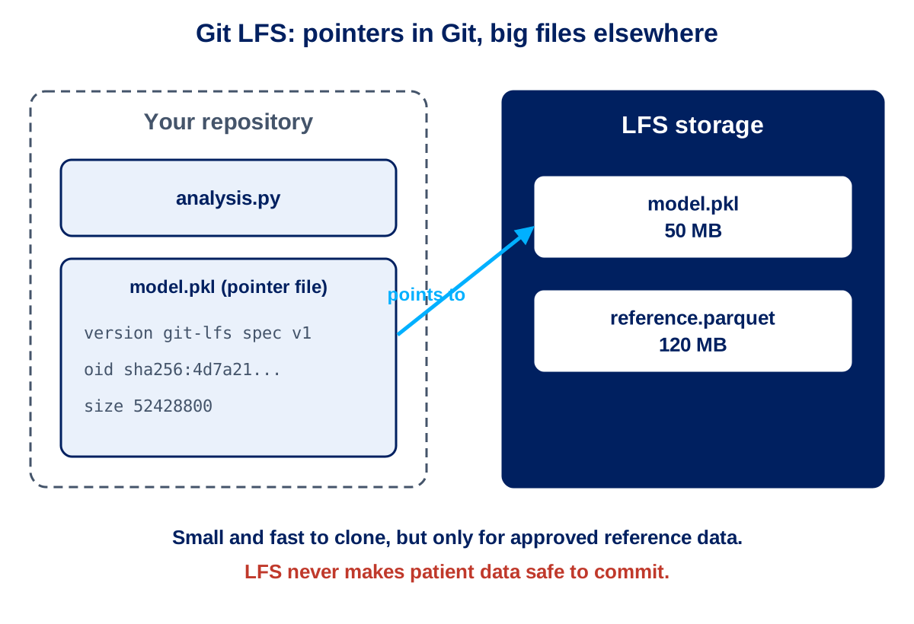

 

---

# Session 5: Codespaces Workspace and File Management

**Duration**: 30 minutes  
**Time**: 12:15 - 12:45

## Learning Objectives

By the end of this session, you will understand:

- How to use a Codespace as your everyday workspace (GitHub Desktop is an optional alternative)
- How to manage large files and datasets with Git LFS
- Local workflow optimization for analytics projects
- Integration with data science tools and environments
- Best practices for notebook and data file management

---

## Codespaces as Your Daily Workspace

From this point in the day your **Codespace** is the main place you work. It is VS Code in the browser, with Git signed in and the Python tools installed, so there is nothing to set up on your own computer.

| Task | In a Codespace |
|------|----------------|
| Start the day | Open your Codespace on your branch, then `git pull` |
| See what changed | **Source Control** view, or `git status` and `git diff` |
| Commit | Write a message in Source Control and commit, or `git commit -m` |
| Share | `git push`, or the **Sync Changes** button |
| Finish | Push, then **Stop Current Codespace** |

> Synthetic data only. A Codespace runs in GitHub's cloud, outside the Secure Data Environment. Session 8 goes deeper on dev containers, governance and Copilot.

**Your Area checkpoint:** add `notes.md` in your Codespace and confirm that a CSV file in your folder is ignored by your `.gitignore`.

---

## GitHub Desktop Overview (Optional)

> GitHub Desktop is an **optional** alternative for people who prefer a point-and-click tool on a local machine. The training uses Codespaces, and the Git skills are the same in both. Skim this section, and use it only if you want it.

### What is GitHub Desktop?

GitHub Desktop is a GUI application that simplifies Git and GitHub workflows, making version control accessible to users who prefer visual interfaces over command-line tools.

### When to Use GitHub Desktop

#### Ideal Scenarios for Data Teams

**New Team Members**
- Learning Git concepts without command-line complexity
- Building confidence with version control workflows
- Understanding branching and merging visually

**Daily Development Work**
- Quick commits and pushes for routine analytics updates
- Visual branch management and switching
- Simple merge conflict resolution

**File Management**
- Staging specific changes from large analytics files
- Reviewing changes before committing
- Managing multiple repositories across different projects

#### ❌ When Command Line is Better

**Complex Operations**
- Advanced Git operations (interactive rebase, cherry-pick)
- Automated scripting and CI/CD integration
- Large-scale repository management

**Performance**
- Very large repositories with thousands of files
- Bulk operations across multiple repositories
- Server environments without GUI access

---
---

## 📁 Core GitHub Desktop Features

### Repository Management

#### Cloning Repositories

**From GitHub.com**:
1. Open GitHub Desktop
2. File → Clone Repository from the Internet
3. Search for "repo-name" organization repositories
4. Select target repository (e.g., patient-analytics)
5. Choose local directory location
6. Clone and open

**From URL**:
```text
Repository URL Examples:
https://github.com/nhs-wales/patient-analytics
https://github.com/nhs-wales/emergency-metrics
https://github.com/nhs-wales/bed-management
```

#### Repository Switching

```text
Current Repository: patient-analytics (main)
Recent Repositories:
├── emergency-metrics (feature/wait-times)
├── bed-management (main)
└── quarterly-reports (feature/q1-2024)

Quick Switch: Ctrl+Shift+O
```

### Commit Workflow

#### Visual Staging

GitHub Desktop shows changes in an intuitive interface:

```text
📄 Changes Tab:
├── ✅ sql/patient_metrics.sql         (+15 -3)
├── ⬜ python/analysis/readmissions.py (+45 -12)
├── ⬜ docs/methodology.md             (+8 -0)
└── ⬜ .gitignore                      (+2 -0)

Selected for Commit: 1 file
```

**Partial Staging**: Select specific lines within files for commit

#### Commit Creation

```text
Commit Interface:
┌─ Summary (required) ─────────────────────────┐
│ Update patient risk calculation methodology │
└─────────────────────────────────────────────┘

┌─ Description (optional) ─────────────────────┐
│ - Align with NHS England clinical guidelines │
│ - Improve accuracy for elderly patients      │
│ - Add validation against historical data     │
│                                              │
│ Closes #234                                │
└──────────────────────────────────────────────┘

[Commit to feature/risk-model-update]
```

### Branch Management

#### Visual Branch View

```text
Branch Timeline:
main ──●────●────●────●────● (Latest: Fix dashboard error)
       │    │    │    │
       │    │    └─●──●──● feature/covid-analysis
       │    │         
       │    └─●────●────● feature/bed-metrics (YOU ARE HERE)
       │
       └─●────● hotfix/urgent-fix
```

#### Branch Operations

**Creating Branches**:
1. Current Branch → New Branch
2. Enter descriptive name: `feature/emergency-wait-analysis`
3. Base branch: `main` (default)
4. Create branch and switch

**Switching Branches**:
- Click current branch name
- Select target branch from dropdown
- GitHub Desktop handles file switching automatically

**Merging Branches**:
1. Switch to target branch (usually `main`)
2. Branch → Merge into current branch
3. Select source branch
4. Handle any conflicts
5. Complete merge

---

## Working with Files

### SQL File Management

#### Tracking SQL Changes

```sql
-- patient_readmissions.sql
-- GitHub Desktop shows line-by-line changes

  SELECT 
      patient_id,
      admission_date,
-     discharge_date,
+     discharge_date,
+     readmission_date,
+     CASE WHEN readmission_date <= discharge_date + INTERVAL '30 days'
+         THEN 1 ELSE 0 END as readmitted_30day
  FROM patient_admissions
- WHERE discharge_date >= '2024-01-01';
+ WHERE discharge_date >= '2024-01-01'
+     AND admission_type != 'PLANNED';
```

**GitHub Desktop Benefits**:
- ✅ Clear visual diff of SQL changes
- ✅ Line-by-line staging for focused commits
- ✅ Syntax highlighting for readability
- ✅ Easy rollback of unwanted changes

#### Best Practices for SQL Files

```text
SQL File Organization:
├── sql/
│   ├── extracts/           # Data extraction queries
│   │   ├── patient_data.sql
│   │   └── lab_results.sql
│   ├── transforms/         # ETL and processing
│   │   ├── clean_demographics.sql
│   │   └── calculate_metrics.sql
│   └── reports/           # Reporting queries
│       ├── monthly_summary.sql
│       └── executive_dashboard.sql

Commit Strategy:
✅ One logical change per commit
✅ Test queries before committing
✅ Include sample results in commit message
✅ Reference related issues or requirements
```

### Python and Notebook Management

#### Jupyter Notebook Challenges

**Common Issues**:
- Cell execution counts change frequently
- Output data can be large and change often
- Metadata includes system-specific information
- Merge conflicts are complex to resolve

**GitHub Desktop Solutions**:

```text
Notebook Workflow:
1. Clear outputs before committing
   - Cell → All Output → Clear
   
2. Use .gitignore for temporary files
   - Add *.ipynb_checkpoints/
   - Add .DS_Store (Mac) or Thumbs.db (Windows)
   
3. Consider script versions
   - Export important notebooks as .py files
   - Commit both .ipynb and .py versions
```

#### Python File Management

```python
# patient_analysis.py
# GitHub Desktop excellently handles Python changes

def calculate_readmission_risk(patient_data):
    """
    Calculate 30-day readmission risk score.
    
    Updated methodology based on clinical validation.
    """
-   # Old calculation method
-   risk_score = age * 0.1 + comorbidities * 0.3
    
+   # Updated calculation with clinical validation
+   # Reference: NHS Clinical Guidelines CG456 (2024)
+   base_risk = age * 0.08
+   comorbidity_risk = comorbidities * 0.35
+   history_risk = prior_admissions * 0.12
+   
+   risk_score = base_risk + comorbidity_risk + history_risk
    
    return min(risk_score, 1.0)  # Cap at 100%
```

---

## Large Files and Git LFS

### Understanding Large File Limitations

#### Git Repository Size Limits

```text
GitHub Repository Limits:
├── Repository size: 1 GB recommended, 5 GB hard limit
├── Individual file size: 100 MB limit
├── Git clone performance: Degrades with large files
└── Storage costs: Large files count against quota
```

#### Common Large Files in Analytics

```text
Healthcare Analytics Large Files:
├── 📊 Raw datasets (.csv, .xlsx, .parquet)
├── 🧠 Machine learning models (.pkl, .joblib, .h5)
├── 📈 Generated reports (.pdf, .html with embedded charts)
├── 🖼️ Visualisation outputs (.png, .svg, complex charts)
└── 📚 Documentation (.docx, .pptx with embedded media)
```

### Git LFS (Large File Storage)

#### What is Git LFS?

Git LFS replaces large files with text pointers inside Git, while storing the actual file content on a separate server.

```text
Without LFS:               With LFS:
Repository                 Repository
├── small_files.sql       ├── small_files.sql
├── [5MB dataset.csv]     ├── dataset.csv (pointer)
├── [50MB model.pkl]      ├── model.pkl (pointer)
└── analysis.py           └── analysis.py

                          LFS Server
                          ├── [5MB dataset.csv]
                          └── [50MB model.pkl]
```

#### Installing Git LFS

```bash
# Install Git LFS (if not already installed)
git lfs install

# Configure LFS for specific file types
git lfs track "*.csv"
git lfs track "*.pkl" 
git lfs track "*.parquet"
git lfs track "*.h5"

# Add .gitattributes file to repository
git add .gitattributes
git commit -m "Configure Git LFS for large healthcare data files"
```

#### GitHub Desktop LFS Integration

```text
GitHub Desktop LFS Features:
✅ Automatic LFS detection for large files
✅ Visual indicators for LFS-tracked files
✅ Simplified LFS setup and configuration
✅ Progress indicators for LFS uploads/downloads
```

---

## Local Workflow Optimization

### Repository Organization

#### Multi-Repository Strategy

```text
GitHub Desktop Local Structure:
C:\GitHub\
├── 01-shared-resources\
│   ├── nhs-wales-standards\    # Coding standards and templates
│   ├── clinical-guidelines\    # Reference documentation
│   └── data-dictionaries\      # Shared data schemas
├── 02-site-specific\
│   ├── cardiff-analytics\      # Cardiff-specific projects
│   ├── swansea-analytics\      # Swansea-specific projects
│   └── newport-analytics\      # Newport-specific projects
├── 03-collaborative\
│   ├── wales-wide-reporting\   # Cross-site projects
│   ├── research-projects\      # Joint research initiatives
│   └── compliance-audits\      # Regulatory compliance work
└── 04-personal\
    ├── training-exercises\     # Learning and development
    ├── experimental-analysis\  # Personal experimentation
    └── scratch-work\          # Temporary work (not versioned)
```

#### Folder Structure Best Practices

```text
Individual Repository Structure:
patient-readmission-analysis/
├── .github/                # GitHub-specific files
│   ├── workflows/         # Automated processes
│   └── ISSUE_TEMPLATE/    # Standardized issue forms
├── data/                  # Data files and documentation
│   ├── raw/              # Original, immutable data
│   ├── processed/        # Cleaned and transformed data
│   └── documentation/    # Data dictionaries and schemas
├── src/                   # Source code
│   ├── sql/              # SQL queries and procedures
│   ├── python/           # Python scripts and modules
│   └── notebooks/        # Jupyter notebooks for exploration
├── tests/                 # Automated tests and validation
├── docs/                  # Project documentation
├── config/               # Configuration files
├── output/               # Generated results (usually not versioned)
└── README.md             # Project overview and setup instructions
```

#### Keyboard Shortcuts for Efficiency

```text
GitHub Desktop Shortcuts:
Ctrl+Shift+O    Switch repository
Ctrl+Shift+`    Open repository in terminal
Ctrl+`          Open repository in external editor
Ctrl+1          Go to Changes tab
Ctrl+2          Go to History tab
Ctrl+3          Go to Pull Requests tab
Ctrl+Enter      Commit changes
Ctrl+P          Push to origin
Ctrl+Shift+P    Pull from origin
```

---


## 🚨 Troubleshooting Common Issues

### Authentication Problems

#### GitHub Authentication Failures

```text
Problem: "Authentication failed" when pushing changes

Solutions:
1. Re-authenticate in GitHub Desktop:
   - File → Options → Accounts
   - Sign out and sign back in
   - Verify NHS Wales organization access

2. Check two-factor authentication:
   - Ensure 2FA app is working
   - Use personal access token if required
   - Verify token has appropriate scopes

3. Network/firewall issues:
   - Check NHS Wales firewall settings
   - Verify GitHub.com is accessible
   - Try VPN if working remotely
```

#### SSH Key Issues

```bash
# Check SSH key status
ssh -T git@github.com

# Generate new SSH key if needed
ssh-keygen -t ed25519 -C "your.email@nhs.wales"

# Add to GitHub account
# Copy public key content and add to GitHub → Settings → SSH Keys
```

### Repository Issues

#### Large Repository Performance

```text
Problem: GitHub Desktop slow with large repositories

Solutions:
1. Use Git LFS for large files:
   - Track large file types: git lfs track "*.csv"
   - Migrate existing large files to LFS
   - Clean up repository history if needed

2. Shallow clone for large repositories:
   - Clone with limited history
   - Focus on recent commits only
   - Full history available on demand

3. Repository cleanup:
   - Remove unused branches
   - Archive old repositories
   - Use submodules for large dependencies
```

#### Merge Conflicts in GitHub Desktop

```text
Visual Conflict Resolution:
1. GitHub Desktop detects conflicts
2. Click "Open in [External Editor]"
3. Resolve conflicts manually:
   <<<<<<< HEAD (your changes)
   SELECT * FROM patients WHERE age > 65;
   =======
   SELECT * FROM patients WHERE age >= 65;
   >>>>>>> feature/elderly-analysis (incoming changes)

4. Remove conflict markers
5. Save file
6. Return to GitHub Desktop
7. Mark conflicts as resolved
8. Complete merge commit
```


---

## Specific Considerations

### Compliance and Security

#### Data Governance

```text
File Management Compliance:
✅ Never commit patient identifiable information
✅ Use data classification tags in file names
✅ Follow NHS Wales retention policies
✅ Document data sources and lineage
✅ Implement access controls for sensitive repositories

Example file naming:
✅ patient_metrics_anonymized_2024q1.csv
✅ risk_model_pseudonymized_v2.pkl
❌ patient_list_with_NHS_numbers.csv
❌ john_smith_medical_history.xlsx
```

#### Audit Requirements

```text
Audit Trail Maintenance:
1. Commit message standards:
   - Reference clinical guidelines where applicable
   - Document methodology changes
   - Include validation evidence
   - Link to business requirements

2. File organization:
   - Separate sensitive and non-sensitive data
   - Use clear folder structures
   - Document external data dependencies
   - Maintain change logs

3. Access management:
   - Regular review of repository access
   - Role-based permissions
   - Temporary access for external collaborators
   - Monitor for unauthorised changes
```

#### Synchronization Workflows

```text
Multi-Site Workflow:
1. Daily synchronization:
   - Pull latest changes from shared repositories
   - Push site-specific updates
   - Review cross-site pull requests

2. Weekly coordination:
   - Review shared methodology updates
   - Discuss upcoming changes affecting multiple sites
   - Plan synchronized releases

3. Monthly collaboration:
   - Share lessons learned and best practices
   - Review repository access and permissions
   - Plan collaborative projects
```

---

## Practical Exercises

### Exercise 1: GitHub Desktop Setup and Workflow

Follow these step-by-step instructions to complete the exercise:

1. **Install and Open GitHub Desktop**
   - Download and install GitHub Desktop if not already installed.
   - Launch the application and sign in with your GitHub account.

2. **Clone a Repository**
   - Click `File → Clone Repository`.
   - Search for the target repository (e.g., `patient-analytics`) or enter its URL.
   - Select a local directory and clone the repository.

3. **Create a New Branch**
   - Click the current branch name at the top.
   - Select `New Branch`.
   - Enter a descriptive branch name (e.g., `feature/add-readme-update`).
   - Click `Create Branch` and switch to it.

4. **Make a Change or Upload a Document**
   - Open the repository folder on your computer.
   - Edit an existing file or add a new document (e.g., upload a PDF or update a Markdown file).
   - Return to GitHub Desktop to see your changes listed in the Changes tab.

5. **Stage, Commit, and Push Your Change**
   - Select the files or lines you want to commit.
   - Enter a clear commit summary and optional description.
   - Click `Commit to [your branch name]`.
   - Click `Push origin` to upload your branch and changes to GitHub.

6. **Create a Pull Request via GitHub Desktop**
   - After pushing, click `Create Pull Request` in GitHub Desktop.
   - Fill in the pull request title and description.
   - Confirm the base branch (usually `main`) and your feature branch.
   - Submit the pull request for review.

*Tip: Use visual diff tools in GitHub Desktop to review your changes before committing. Ensure your commit messages are descriptive and reference any relevant issues or requirements.*


---

## Session 5 Recap

### Key Skills Developed

#### 1. GitHub Desktop Proficiency

- **Installation and setup** for NHS Wales environment
- **Repository management** across multiple projects
- **Visual Git operations** without command-line complexity
- **Integration** with data science tools and workflows

#### 2. Large File Management

- **Git LFS understanding** and implementation
- **Best practices** for healthcare data files
- **Performance optimization** for analytics repositories
- **Compliance considerations** for sensitive data

#### 3. Local Workflow Optimization

- **Multi-repository organization** for complex projects
- **Efficient daily workflows** for analytics teams
- **Tool integration** with VS Code, SSMS, and Jupyter
- **Troubleshooting common issues** and solutions

### Best Practices for NHS Wales Teams

#### Daily Workflow

```text
GitHub Desktop Best Practices:
✅ Start day with repository sync across all projects
✅ Create focused feature branches for specific tasks
✅ Commit frequently with descriptive messages
✅ Use visual diff review before committing
✅ End day with push to backup all work
```

#### File Management

```text
Data Management:
✅ Use Git LFS for reference data and models
✅ Never commit patient identifiable information
✅ Organize repositories by project and sensitivity
✅ Clear notebook outputs before committing
✅ Document data dependencies and sources
```

#### Team Collaboration

```text
Multi-Dev Collaboration:
✅ Regular synchronization with shared repositories
✅ Clear communication about large changes
✅ Consistent naming conventions across sites
✅ Shared standards for code quality and documentation
✅ Regular cleanup of stale branches and files
```

## Next Session Preview

**Session 6: VS Code Integration and Notebooks**

- Deep integration between VS Code and GitHub
- Advanced features for data science workflows
- Jupyter notebook best practices with version control
- Extensions and tools for healthcare analytics
- Collaborative development in integrated environments

---

## 📚 Additional Resources

- [GitHub Desktop Documentation](https://docs.github.com/en/desktop)
- [Git LFS Best Practices](../Technical_Configuration/README.md)
- [NHS Wales File Management Guidelines](../Technical_Configuration/2.2%20Repo_Configuration.md)
- [Data Science Tool Integration](../GitHub_Copilot_Guide/README.md)

*Session 5 of 9 | GitHub Training Series for Analytics and Data Teams*  
*Developed by ABUHB Business Intelligence Team*

---

<!-- SLIDES:BEGIN - generated by Training/slides/build_deck.py from slides/deck_content.yaml. Do not edit by hand. -->
## 🖥️ Slide Deck Content

These are the slides for this session: **slides 36–41** of [`GitHub_Training_Day.pptx`](GitHub_Training_Day.pptx). They are generated from [`slides/deck_content.yaml`](slides/deck_content.yaml), so the deck and this page always match. The sections above give the full detail behind each slide.

### Slide 36: Section divider

**Codespaces Workspace and File Management** — Session 5 | 30 minutes

### Slide 37: Codespaces as Your Daily Workspace

**Why Codespaces first**

- Nothing to install, so it works on locked-down NHS machines
- Everyone gets the same Python tools and settings
- Git is already signed in to your account
- Your work stays on your branch in GitHub

**A daily rhythm**

- Open your Codespace on your own branch and pull the latest main
- Make small changes and commit often
- Push before you finish, then stop the Codespace

> Synthetic data only. A Codespace runs outside the Secure Data Environment.

### Slide 38: GitHub Desktop (Optional)

**A visual alternative**

- A point-and-click way to clone, branch, commit and sync
- Useful if you prefer it or work on a local machine

**Why we start with Codespaces**

- Fewer installs and sign-in problems on training day
- The same Git skills apply in both tools

### Slide 39: Large Files and Git LFS

**The problem**

- GitHub recommends repositories under 1 GB, with a 100 MB limit per file
- Datasets, models and reports quickly exceed this

**Git LFS**

- Keeps small pointers in Git and the real file on a separate server
- Use it for reference data and models

**Never commit patient identifiable information — LFS does not change that.**



### Slide 40: Daily Workflow and Good Habits

**A good day in a Codespace**

- Pull the latest main at the start of the day
- Use focused feature branches
- Commit often with descriptive messages
- Review the diff in the Source Control view before committing
- Push at the end of the day, then stop your Codespace

**Managing files**

- Clear notebook outputs before committing
- Document data sources and dependencies

### Slide 41: Your Area: Checkpoint 5

**Add notes from your Codespace (4 minutes)**

- Reopen your Codespace on your branch and run git pull to pick up the web edit
- Copy Participant_Pack/04_My_Notes_Template.md into your folder as notes.md and fill in Sessions 1 to 5
- Create data.csv with five made-up rows and check the Source Control view does not list it
- Commit and push

**Your folder now contains**

- notes.md added; data.csv is ignored and never appears as a change

<!-- SLIDES:END -->
