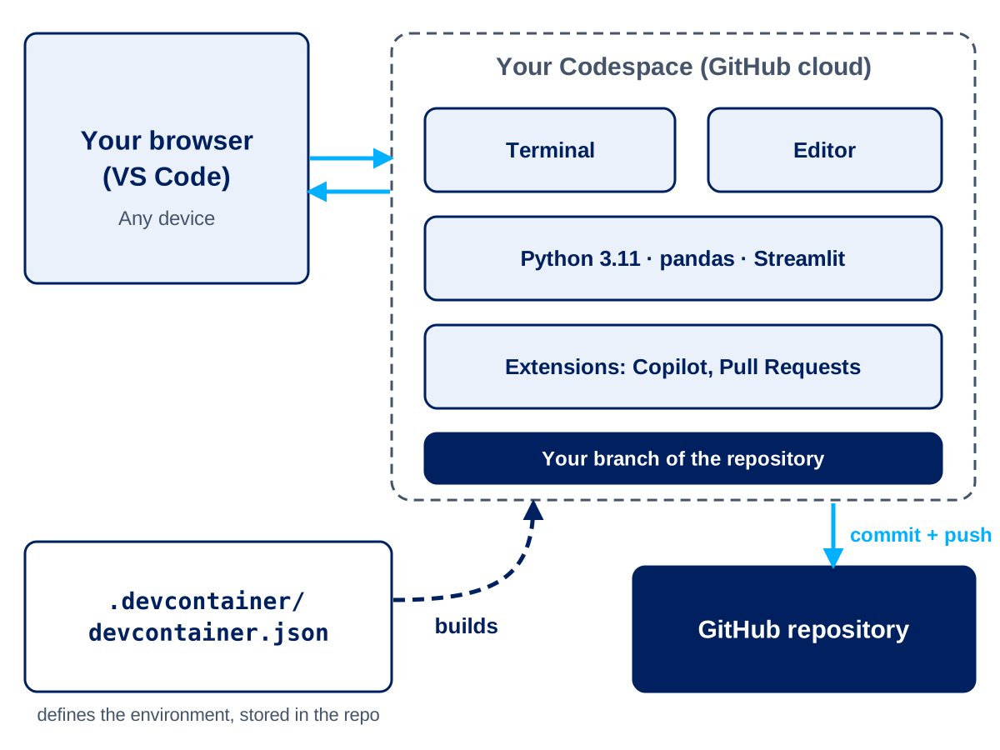
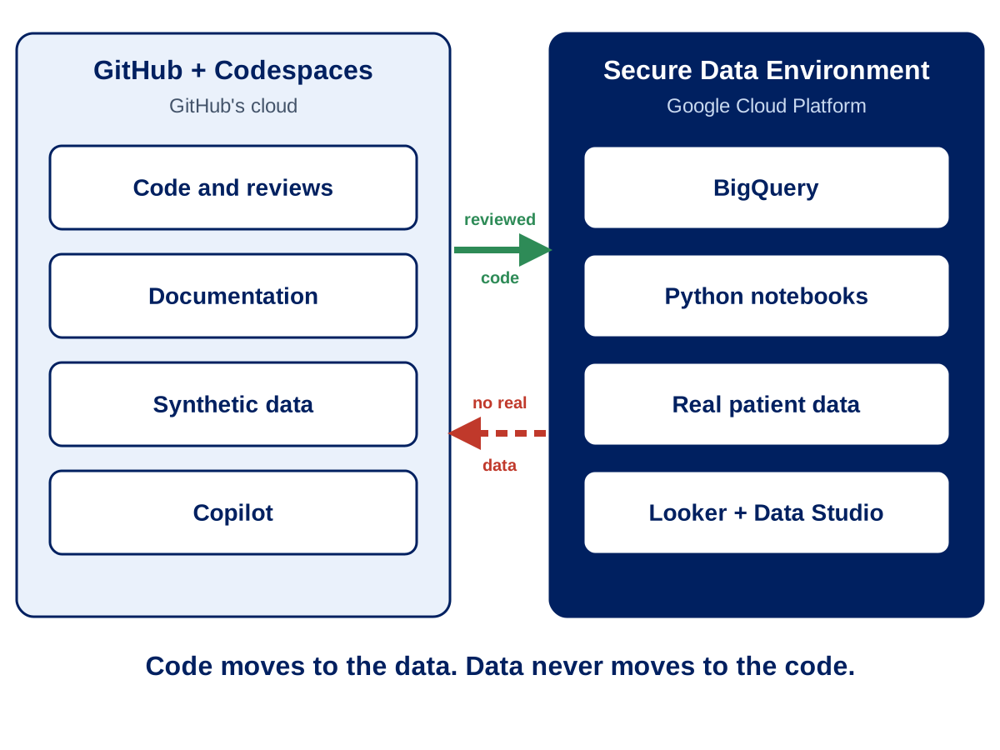

 

---

# Session 8: GitHub Codespaces and Copilot Hands-On

**Duration**: 45 minutes  
**Time**: 13:50 - 14:35

## 🎯 Learning Objectives

By the end of this session, you will be able to:

- Explain what a GitHub Codespace is and when to use one instead of working locally
- Open, use and stop a Codespace safely
- Describe how a dev container gives everyone the same environment
- Say what does and doesn't belong in a Codespace (information governance)
- Use GitHub Copilot to suggest, explain and fix code, and review its output critically
- Build a small piece of analysis code **or** a simple user interface with Copilot, then save it the GitHub way (branch → commit → pull request)

> **Format:** about 17 minutes of demonstration and discussion, then a 25-minute hands-on exercise, then a short share-back.

| Part | Time | What happens |
|------|------|--------------|
| Codespaces | 10 min | What they are, launching, dev containers, governance |
| Copilot | 7 min | Suggestions, chat, prompting, reviewing |
| Exercise | 25 min | Build an analysis script or a Streamlit app with Copilot |
| Fit with the SDE and share-back | 3 min | Where this sits next to the Secure Data Environment; one quick share-back |

---

## 🖥️ What is a GitHub Codespace?

A **Codespace** is a development environment that runs in the cloud and opens in your browser (or in VS Code). It is VS Code, a terminal, your repository and the right tools - ready to use, with nothing to install on your laptop.

### Why use one?

| Benefit | What it means for analytics teams |
|---------|-----------------------------------|
| **Same environment for everyone** | No "works on my machine". Everyone has the same Python version and packages |
| **Fast onboarding** | A new joiner opens the repository and is ready to work in minutes |
| **Quick fixes and reviews** | Open a Codespace on a pull request branch to run and test the changes |
| **Works from any device** | All you need is a browser |
| **Least-privilege secrets** | Secrets can be scoped to a repository instead of living on local machines |

### Launching a Codespace

```text
1. Open the repository on github.com
2. Select Code → Codespaces → Create codespace on main
3. Wait for the environment to build (the first time takes a little longer)
4. VS Code opens in the browser, with the terminal and your files ready
5. Create a branch before you change anything
```

> A 2-core machine is plenty for this session. Larger machines exist for heavy work but cost more.

### Codespace lifecycle

| State | Meaning |
|-------|---------|
| **Running** | Active and using compute time |
| **Stopped** | Not using compute time. Your files are kept |
| **Deleted** | Removed. Anything you did **not** commit and push is lost |

Good habits:

- **Commit and push** before you stop or delete a Codespace.
- **Stop** your Codespace when you finish (Command Palette → *Codespaces: Stop Current Codespace*, or [github.com/codespaces](https://github.com/codespaces)).
- Codespaces stop themselves after a period of inactivity, but don't rely on that - stop them yourself.
- Delete old Codespaces you no longer need.

### Codespaces vs local

| Situation | Prefer a Codespace | Prefer local |
|-----------|--------------------|--------------|
| New joiner / onboarding | ✅ Ready-made environment | ❌ Set-up friction |
| Identical tooling for a review | ✅ Same container configuration | ❌ Risk of local differences |
| Heavy compute / large datasets | ❌ Cost and quotas | ✅ Local or dedicated environment |
| Unreliable network | ❌ Needs a stable connection | ✅ Works offline |
| Secret management | ✅ Scoped secrets, nothing stored locally | ❌ Risk of local copies |

---

## 📦 Dev Containers: Same Environment for Everyone

A **dev container** is described by one file in the repository: `.devcontainer/devcontainer.json`. It says which Python version to use, which VS Code extensions to install, which ports to forward, and what to run after the Codespace is created.

Because the file is in the repository, a change to the environment goes through a **pull request** like any other change, and everyone gets the new setup next time they create a Codespace.

The dev container for today's exercise (`.devcontainer/devcontainer.json`, shortened here):

```json
{
  "name": "GitHub Training - Codespaces and Copilot",
  "image": "mcr.microsoft.com/devcontainers/python:3.11",
  "postCreateCommand": "pip install -r Training/exercises/codespaces-copilot/requirements.txt",
  "forwardPorts": [8501],
  "customizations": {
    "vscode": {
      "extensions": [
        "ms-python.python",
        "ms-toolsai.jupyter",
        "GitHub.copilot",
        "GitHub.copilot-chat",
        "GitHub.vscode-pull-request-github"
      ]
    }
  }
}
```

| Setting | Purpose |
|---------|---------|
| `image` | Python 3.11 base image |
| `postCreateCommand` | Installs pandas, matplotlib, Streamlit and pytest |
| `forwardPorts` | Port 8501 is where the Streamlit app appears |
| `extensions` | Python, Jupyter, Copilot and pull request tools |

> The full file in the repository also sets editor options and opens the exercise instructions automatically.

---

## 🔒 What Belongs in a Codespace?

A Codespace runs in **GitHub's cloud**. It is **not** part of the Secure Data Environment (SDE).

| ✅ Safe to use | ❌ Never use |
|----------------|--------------|
| Code, documentation and configuration | Patient-identifiable data of any kind |
| Notebooks with outputs cleared | Extracts, NHS numbers, names, addresses |
| **Synthetic** or fully anonymised sample data | Passwords, tokens, keys or connection strings in files |

Rules to remember:

1. **Real data stays in the SDE.** Develop with synthetic data in GitHub, then run the reviewed code against real data inside the SDE.
2. **No secrets in the repository.** Use environment variables or Codespaces secrets.
3. **No patient data in Copilot prompts**, comments or file names.
4. **Follow organisational policy** on who may create Codespaces and who pays for them. If you can't create one, ask your GitHub administrator.

---

## 🤖 GitHub Copilot: Suggest, Chat and Slash Commands

**GitHub Copilot** is an AI coding assistant inside VS Code (and therefore inside a Codespace). Appendix A1 covers Copilot in more depth; this session focuses on using it well in a real task.

### Three ways to use it

| Way | How | Good for |
|-----|-----|----------|
| **Inline suggestions** | Write a comment or a function name; Copilot suggests code. `Tab` accepts, `Esc` dismisses | Boilerplate, small functions |
| **Copilot Chat** | Ask questions in the chat panel about your code, data or an error | Explaining, planning, debugging |
| **Slash commands** | In chat: `/explain`, `/fix`, `/tests`, `/doc` | Common jobs on selected code |

### Shared instructions for the team

A file called `.github/copilot-instructions.md` in the repository gives Copilot Chat standing instructions for **everyone** who works in the repo: coding standards, UK English, what the metric definitions are, and what never to generate (such as real identifiers or hard-coded secrets). Open it in the repository to see an example.

### Prompting and reviewing

**Get better answers**

- Give context: the columns, the metric definition, the output you want.
- Work in **small steps** and iterate, rather than asking for everything at once.
- Ask Copilot to **explain** anything you don't understand.

**You are the reviewer**

- Never accept code you can't explain. Copilot can be confidently wrong.
- Check definitions, totals and any invented function or column names, then **run and test** the code.
- Keep patient data and secrets out of prompts.
- All Copilot-assisted code goes through the same pull request review as any other code.

> Copilot is not suitable for clinical logic (for example dosage calculations or clinical decision rules) without clinical review. See Appendix A1 for the full guidance.

---

## 🧪 Exercise: Build Something with Copilot (25 minutes)

Work alone or in pairs. The full step-by-step guide is in
[`exercises/codespaces-copilot/README.md`](exercises/codespaces-copilot/README.md).

### The scenario

An outpatient service manager asks: *"Which clinics and patient groups have the highest DNA (did not attend) rates, and is it changing through the year?"*

You have a **synthetic** dataset of 3,000 outpatient appointments
(`data/synthetic_outpatient_appointments.csv`). **Metric definition:** `DNA rate = DNA ÷ (Attended + DNA)`. Cancelled appointments are **excluded**.

### Choose your track

| Track | What you build |
|-------|----------------|
| **A. Analysis** | A Python script that checks the data, calculates DNA rates by speciality, age band and month, and saves a chart |
| **B. UI** | A Streamlit app with filters, headline numbers and charts |

### Steps

1. **Open a Codespace** on the training repository and create your own branch.
2. **Ask Copilot to explain the data columns.** Compare its answer with the data dictionary.
3. **Build your track in small steps.** Read every suggestion before accepting it.
4. **Run it:** `python <your_file>.py` for Track A, or `streamlit run <your_file>.py` for Track B.
5. **Review Copilot's work** using the checklist below.
6. **Commit, push and open a pull request** for a neighbour to review.
7. **Stop your Codespace.**

### Review checklist

```text
□ Does the DNA rate exclude cancelled appointments?
□ Do the totals add up to 3,000 appointments?
□ Any invented column names or library functions? Does the code run?
□ Any hard-coded paths, secrets, or code that sends data elsewhere?
□ Could you explain every line to a colleague?
□ Are chart titles and labels clear, and in UK English?
```

### Share back

| Item | Answer |
|------|--------|
| Track chosen | A or B |
| One thing Copilot did well | |
| One thing Copilot got wrong, or that you had to fix | |
| Would you use this at work? For what? | |

### Instructor notes

- Reference solutions (`solution_analysis.py`, `solution_app.py` and `test_solution.py`) are in `exercises/codespaces-copilot/instructor/`.
- **Before the session, confirm:** Codespaces is enabled for the organisation, Copilot seats are assigned, and who pays for Codespaces usage.
- **No seat or no permission?** Run it as a pair exercise on one person's screen, or demonstrate from the instructor's Codespace.
- **Stretch tasks:** ask Copilot to write tests; edit `.github/copilot-instructions.md` and see how the answers change; add an extra filter or chart.

---

## 🔗 How This Fits with the Secure Data Environment

The Codespaces exercise deliberately stays **inside GitHub**. There is no link to Google Cloud Platform (GCP) in this session, and no cloud credentials are used.

| Where | What it is for |
|-------|----------------|
| **GitHub and Codespaces** | Code, documentation, reviews, and **synthetic** data |
| **Secure Data Environment (GCP)** | **Real** data, BigQuery queries and Python notebooks |

The path from idea to real analysis:

```text
Develop and test with Copilot on synthetic data in a Codespace
        ↓
Review through a pull request and merge to main
        ↓
Run the reviewed code inside the SDE, against real data
```

**Code moves to the data. Data never moves to the code.**

For how GitHub connects to GCP and the SDE (for example pulling code from GitHub into notebooks, and CI/CD), see [Appendix A5: GitHub with Google Cloud Platform](../Appendix/A5_GitHub_with_GCP.md).

---

## ✅ Session 8 Recap

```text
You can now:
✅ Open, use and stop a Codespace
✅ Explain how a dev container gives everyone the same environment
✅ Say what belongs in a Codespace - and what stays in the SDE
✅ Use Copilot suggestions, chat and slash commands
✅ Review Copilot's output critically before it reaches a pull request
✅ Take a small piece of work from Codespace to pull request
```

---

## 🎯 Next Session Preview

**Session 9: Group Exercises and Consolidation**

- Review of the day
- A team exercise from issue to merge
- Next steps for using GitHub in your work

---

## 📖 Additional Resources

- [GitHub Codespaces documentation](https://docs.github.com/en/codespaces)
- [GitHub Copilot documentation](https://docs.github.com/en/copilot)
- [Appendix A1: GitHub Copilot and Agents](../Appendix/A1_GitHub_Copilot_and_Agents.md)
- [Appendix A7: Hybrid Workflow Integration](../Appendix/A7_Hybrid_Workflow.md)

---

<!-- SLIDES:BEGIN - generated by Training/slides/build_deck.py from slides/deck_content.yaml. Do not edit by hand. -->
## 🖥️ Slide Deck Content

These are the slides for this session: **slides 58–69** of [`GitHub_Training_Day.pptx`](GitHub_Training_Day.pptx). They are generated from [`slides/deck_content.yaml`](slides/deck_content.yaml), so the deck and this page always match. The sections above give the full detail behind each slide.

### Slide 58: Section divider

**Codespaces and Copilot Hands-On** — Session 8 | 45 minutes

### Slide 59: What is a GitHub Codespace?

**VS Code in the cloud**

- A ready-to-use development environment, opened from a repository in your browser
- Python, packages and extensions are installed for you
- No local installation — start coding in minutes

**Why use one?**

- Everyone gets the same environment — no "works on my machine"
- Great for onboarding, quick fixes and reviewing pull requests
- Your work is committed back to the repository with Git



### Slide 60: Codespaces: Launching and Lifecycle

**Launching**

- Repository → Code → Codespaces → Create codespace on main
- Create a branch before you change anything
- A 2-core machine is plenty for today

**Lifecycle**

- Running → Stopped → Deleted
- Stop it when you finish — stopped Codespaces don't use compute time
- Commit and push first; uncommitted work is lost if a Codespace is deleted

### Slide 61: Dev Containers: Same Environment for Everyone

**One file defines the environment**

- .devcontainer/devcontainer.json lives in the repository
- Sets the Python version, extensions, ports and setup commands
- Change the file in a pull request, and everyone gets the new setup

**Today's setup**

- Python 3.11 with pandas, matplotlib and Streamlit
- Copilot and Pull Request extensions pre-installed
- Port 8501 forwarded for the Streamlit app

### Slide 62: What Belongs in a Codespace?

**Safe to use**

- Code, documentation and notebooks with outputs cleared
- Synthetic or fully anonymised sample data

**Never use**

- Patient-identifiable data, extracts or NHS numbers
- Passwords, tokens or keys in files — use Codespaces secrets

**A Codespace runs in GitHub's cloud, outside the Secure Data Environment. Real data stays in the SDE.**

### Slide 63: GitHub Copilot: Suggest, Chat and Slash Commands

**Inline suggestions**

- Write a comment or function name — Copilot suggests the code
- Press Tab to accept, Esc to dismiss

**Copilot Chat**

- Ask questions about your code, data or errors
- /explain, /fix, /tests and /doc for common jobs
- Shared repository instructions keep answers consistent (.github/copilot-instructions.md)

### Slide 64: Prompting and Reviewing Copilot

**Get better answers**

- Give context — the columns, the metric definition, the output you want
- Work in small steps and iterate
- Ask Copilot to explain code you don't understand

**You are the reviewer**

- Never accept code you can't explain — Copilot can be confidently wrong
- Check definitions, totals and invented functions, then test
- No patient data or secrets in prompts

### Slide 65: Exercise: Choose Your Track

**The scenario**

- Which clinics and patient groups have the highest DNA (did not attend) rates, and is it changing through the year?
- Synthetic outpatient dataset — 3,000 appointments

**Pick one**

- Track A — Analysis. Python script that checks the data, calculates DNA rates and saves a chart
- Track B — UI. A Streamlit app with filters, headline numbers and charts

> DNA rate = DNA ÷ (Attended + DNA). Cancelled appointments are excluded.

### Slide 66: Exercise: Build with Copilot (25 minutes)

**Steps**

- Open a Codespace and create your own branch
- Ask Copilot to explain the data columns
- Build your track in small steps, reading every suggestion
- Run it — python for Track A, streamlit run for Track B
- Commit, push and open a pull request for a neighbour to review
- Stop your Codespace

> Full guide: Training/exercises/codespaces-copilot/README.md

### Slide 67: Exercise: Review and Share Back

**Check Copilot's work**

- Does the DNA rate exclude cancelled appointments?
- Do the totals add up to 3,000 appointments?
- Any invented columns or functions? Does it run?
- Could you explain every line to a colleague?

**Share back**

- Track chosen, and one thing Copilot did well
- One thing Copilot got wrong or you had to fix
- Would you use this at work?

### Slide 68: How This Fits with the Secure Data Environment

**Two places, two jobs**

- GitHub and Codespaces — code, documentation and synthetic data
- Secure Data Environment on GCP — real data, queries and notebooks

**The path to real data**

- Develop and test with Copilot on synthetic data in a Codespace
- Review through a pull request and merge to main
- Run the reviewed code inside the SDE, against real data

**Code moves to the data. Data never moves to the code.**



### Slide 69: Your Area: Checkpoint 8

**Do the exercise in your own folder (25 minutes)**

- Open a Codespace on your branch training/<your-folder>
- Create participants/<your-folder>/dna-analysis and work there
- Commit at least twice with clear messages
- Push when you have worked through the review checklist

**Your folder now contains**

- dna-analysis with your code, a short README and a note of the Copilot prompts you used

<!-- SLIDES:END -->

---

*Session 8 of 9 | GitHub Training Series for Analytics and Data Teams*  
*Developed by ABUHB Business Intelligence Team*
