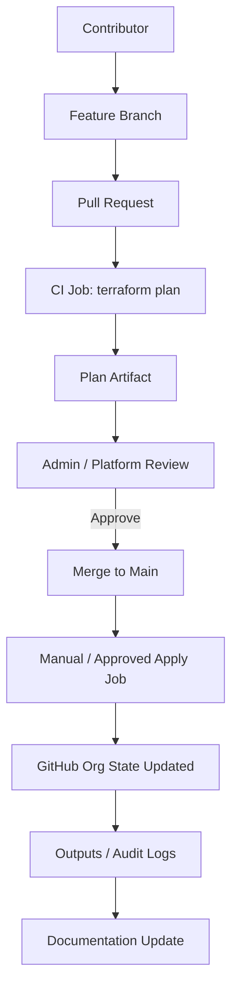

# Session 9 (Optional): GitHub Governance with Terraform & Codespaces

 

**Duration**: 45–60 minutes  
**Time**: Optional - Advanced session  
**Type**: Advanced (platform / governance enablement)  
**Audience**: Technical leads, GitHub administrators, maintainers (not required for all analysts)

---

## 🎯 Objectives

By the end of this session you can:

- Explain when Infrastructure-as-Code (IaC) with Terraform benefits GitHub org & repository governance
- Describe the existing Terraform layout in this repo (`terraform_code/`)
- Safely extend repositories, teams and memberships using variable maps & `for_each` patterns
- Follow a plan → review → apply workflow with auditability
- Use GitHub Codespaces (or local devcontainer) for consistent Terraform execution
- Identify prerequisites (Azure AD group, network / firewall, permissions) before automation

> Treat Terraform as an optional, secondary approach for repeatable configuration – NOT mandatory for day‑to‑day analytics work.

---

## 🧭 Why Terraform for GitHub

| Challenge | Manual Pain | Terraform Benefit |
|-----------|-------------|------------------|
| Repetitive repo setup | Inconsistent settings; human error | Declarative, repeatable, versioned |
| Team membership drift | Hard to audit changes | Single source of truth + plan diffs |
| Branch protection edits | Risk of accidental removal | Policy enforced in code |
| Onboarding / offboarding | Delays or missed revocations | Controlled via code review |
| Org state documentation | Fragmented spreadsheets/wiki | Code + state document configuration |

> Use for standardization, auditability, scaling governance—avoid for highly experimental or ephemeral repos.

---

## 🏗 Existing Terraform Structure

Location: `terraform_code/`

| File | Purpose |
|------|---------|
| `main.tf` | Provider configuration (`github` provider, org owner) |
| `variables.tf` | Input structures for repositories, teams, permissions |
| `repositories.tf` | Repository resources, vulnerability alerts, branch protection |
| `teams.tf` | Team creation + memberships mapping |
| `users.tf` | Organization membership invitations |
| `outputs.tf` | Useful outputs (URLs, IDs, slugs) |
| `terraform.tfvars` / `.example` | Concrete or template variable assignments |

Patterns:

- `for_each` over maps / objects for scalable creation.
- Branch protection settings codified (required reviews, checks, admin enforcement).
- Separation of data (`terraform.tfvars`) from logic (`*.tf`).

---

## 🔐 Prerequisites & Controls

Ensure these are in place BEFORE extending or applying Terraform changes:

| Area | Requirement | Notes |
|------|-------------|-------|
| Identity | GitHub Fine-grained PAT or classic token with required scopes (`repo`, `admin:org`) | Store securely (Codespaces secret, local env var) |
| Azure AD Group | `cymru.nhs.uk/NHS Wales Organisations/Aneurin Bevan Health Board (ABB-7A6)/Groups/BI Reporting Distribution Lists/ABB_BIU_GitHub_Users` | Confirms entitled GitHub user population |
| Network / Firewall | Outbound HTTPS to `api.github.com` allowed | Check proxy / firewall policies on NHS Wales network |
| Admin Contact | `ABB.BIU.GitHub.Admin@nhswales365.onmicrosoft.com` | Central escalation & approvals channel |
| Compliance | Audit logging & review process defined | Link Terraform PRs to change tickets/issues |
| Operator Skills | Team understands plan/apply lifecycle | Prevent accidental destructive changes |

> Never embed tokens directly in `.tf` files. Use environment variables (`GITHUB_TOKEN`) or a secure secret store / remote backend.

### Repository Provisioning Governance

Each new repository must have an approved **HALO ticket** before it is added to `terraform.tfvars`. Contributors may open a PR that adds the repo block referencing the HALO ID (e.g. in the description or PR summary), but **Terraform apply is currently restricted to the GitHub Admin, executed inside a secured Codespace**. This ensures naming, visibility, access levels, and data classification are verified prior to creation.

Workflow summary for new repo:
1. HALO ticket approved (includes name, purpose, classification, access matrix).
2. Feature branch adds repo object to `terraform.tfvars` (include HALO ID comment).
3. PR triggers plan; plan artifact attached for review.
4. Admin validates plan against HALO details.
5. Admin performs Terraform apply in Codespace.
6. Repo URL and team mappings posted back to HALO ticket.

> No direct repository creation via UI without HALO approval and admin Terraform apply.

---

## 🧪 Safe Change Workflow (Recommended)

1. Create feature branch: `feature/terraform-repo-update`  
2. Edit `terraform.tfvars` (add/modify map entry) & any needed logic  
3. Open PR → GitHub Action runs `terraform plan` (non-applying)  
4. Review plan output: confirm expected delta only  
5. Obtain approval (CODEOWNERS / admin)  
6. Merge PR (protected `main`)  
7. Trigger manual "Apply" job (needs approval gate) OR run locally with audited command  
8. Monitor outputs & update documentation if needed

> Keep Plan and Apply distinct. Attach plan artifact to PR for audit.

---

## 🖥 Codespaces / Devcontainer

Using Codespaces ensures consistent tooling (Terraform version, provider cache, linting) without local setup friction.

Recommended dev features:

- Pin Terraform CLI (e.g. `>= 1.6.0`)
- Preinstalled GitHub provider (auto-installs on init if not cached)
- Pre-commit hooks: `terraform fmt`, basic validation
- GitHub CLI (`gh`) optionally for workflow interaction

Example workflow (bash inside Codespace):

```bash
terraform -chdir=terraform_code init
terraform -chdir=terraform_code fmt -check
terraform -chdir=terraform_code validate
terraform -chdir=terraform_code plan -out=tfplan
terraform -chdir=terraform_code show -no-color tfplan > terraform_code/plan_output.txt
# Apply only after PR approval
terraform -chdir=terraform_code apply tfplan
```

PowerShell (local):

```powershell
$Env:GITHUB_TOKEN = "<your_token>"
terraform -chdir=terraform_code init
terraform -chdir=terraform_code fmt -check
terraform -chdir=terraform_code validate
terraform -chdir=terraform_code plan -out=tfplan
terraform -chdir=terraform_code show -no-color tfplan > terraform_code\plan_output.txt
terraform -chdir=terraform_code apply tfplan
```

---

## 🧩 Adding a New Repository (Example)

Add to `terraform.tfvars` (simplified example):

```hcl
repositories = {
  existing_repo = {
    description                   = "Existing repository ..."
    visibility                    = "private"
    topics                        = ["analytics", "governance"]
    enable_vulnerability_alerts   = true
    default_branch_protection = {
      required_status_checks        = []
      required_pull_request_reviews = 1
      enforce_admins                = true
    }
  }
  quality_dashboard = {
    description                   = "Quality metrics dashboard code"
    visibility                    = "private"
    topics                        = ["quality", "dashboard"]
    enable_vulnerability_alerts   = true
    default_branch_protection = {
      required_status_checks        = []
      required_pull_request_reviews = 1
      enforce_admins                = true
    }
  }
}
```

Then run plan → verify only one new repo; review; approve; apply.

Edge Checks:

- Visibility mismatch → adjust before apply.
- Missing review count → update protection block.
- Name collision → GitHub will error; rename & re-plan.

---

## 🛡 Policy & Guardrails

| Guardrail | Implementation |
|----------|----------------|
| Mandatory review on Terraform PRs | Branch protection + `CODEOWNERS` |
| Minimum Terraform version | `terraform { required_version = ">= 1.6.0" }` |
| No applies from forks | Workflow condition `github.event.pull_request.head.repo.fork == false` |
| Plan artifact retention | Upload plan or store `plan_output.txt` in PR artifacts |
| Secret scanning | Enable org secret scanning & push protection |
| Least privilege tokens | Fine-grained PAT scoped to required repos/org settings |

Example Terraform block:

```hcl
terraform {
  required_version = ">= 1.6.0"
  required_providers {
    github = {
      source  = "integrations/github"
      version = ">= 5.90"
    }
  }
}
```

---

## 🗺 Workflow Architecture



---

## 🚫 When NOT to Use Terraform

| Scenario | Reason to Avoid IaC |
|----------|---------------------|
| Experimental throwaway repo | Overhead > value; create manually |
| Highly dynamic membership churn | Frequent drift & noisy plans; prefer SSO group mapping |
| Emergency hotfix settings | Need speed; codify later post-incident |
| Personal sandboxes | Over-governance; autonomy preferred |

> Apply Terraform where stability & repeatability outweigh velocity.

---

## 🔭 Roadmap & Future Enhancements

| Phase | Improvement |
|-------|-------------|
| Short Term | CI plan on every PR + CODEOWNERS enforcement |
| Mid Term | Remote backend (Terraform Cloud / Azure Storage) for centralized state |
| Mid Term | GitHub Actions OIDC for tokenless auth to backend |
| Long Term | Policy as Code (OPA / Sentinel) for repository rule enforcement |
| Long Term | SCIM / SSO group sync to reduce manual team definitions |

---


## ✅ Checklist

```text
□ Confirm prerequisites (token, AD group, network)
□ Use Codespace or devcontainer for consistent Terraform environment
□ Implement change via feature branch + PR
□ Review and store plan artifact before apply
□ Apply only after approval & guardrails pass
□ Update documentation & outputs
```

---

## 🏁 Wrap-Up

You now have a governance model to scale GitHub configuration safely using Terraform plus a reproducible environment approach with Codespaces.

> Start small: pilot with one or two repositories before broad adoption.

*Session 8 (Optional) | GitHub GIG Cymru Training Series*  
*NHS Wales BIU | Business Intelligence Unit*
